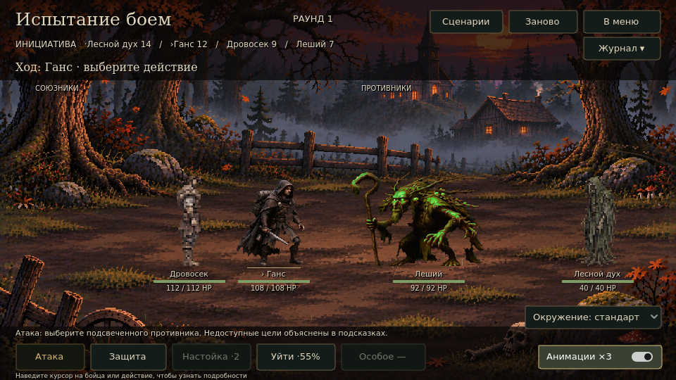
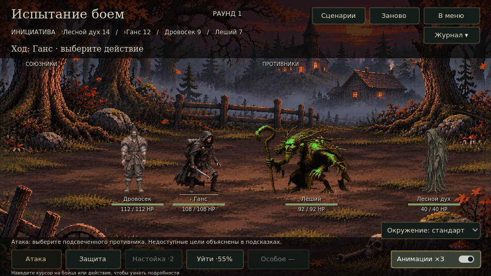

# Hutor Reborn — Combat Visual Overhaul

Дата: 19 ноября 2026. Основа: `main` / `b448069`, после объединённого PR #40. Ветка: `codex/combat-visual-overhaul`. Проверка: официальный Godot **4.6.2**, Linux/X11, Compatibility, Mesa llvmpipe.

## Результат и границы готовности

Исправлено разрушительное выделение дровосека, лесного духа и наёмника из исходных листов. Боевая сцена получила независимые анимированные ветви, траву, дальний туман, листья, свет окон и дым, три уровня качества, небольшой эффект попадания и привязку показа попадания к реальному кадру. Добавлены отдельная лаборатория и повторяемый анализатор графики.

**Это не утверждение, что предварительные исходники стали окончательной графикой.** В некоторых действиях Ганса остались разрывы одежды/тела, где исходник утратил и alpha, и RGB. Они видны на светлом фоне и перечислены ниже. Не дорисовывал анатомию, не скрывал дефекты свечением или прозрачностью. Для полного выполнения художественного критерия «все кадры цельные» нужны исправленные исходные кадры.

Боевая математика, AI, характеристики, очередь, IDs, квесты, сохранения, деревня, интерьеры, модели/анимации NPC на карте и настройки проекта не изменены. Утверждённые Hans Idle v2 Stabilized, Wolf Idle v3, Wolf Attack v3, локальная коррекция лапы, дизайн и анимации лешего сохранены.

## Установленные причины

| Объект | Причина | Исправление |
|---|---|---|
| Дровосек | `tools/prepare_woodcutter_542.py` отбрасывал alpha <128, применял цветовые исключения и морфологическое открытие, затем уменьшал модель до ~49,5 px. В бою увеличивался уже повреждённый атлас. | Боевой атлас восстановлен напрямую из `assets/npc/woodcutter542/source/` по существующему manifest: те же позы, порядок, FPS и равномерные пропорции; сетка 288 вместо 96, Nearest. На карте остаётся прежний атлас. В бою выбран существующий фронтальный `idle_down`. |
| Лесной дух | `tools/prepare_combat_61.py` оставлял только alpha ≥200 и удалял «зелёные» пиксели, включая настоящий мох. В полном исходном листе только 48 пикселей полностью непрозрачны; остальные видимые пиксели преимущественно имеют промежуточную alpha. | Статическая поза заново выделена из сохранённого `stage61/source/fighters.png`. Нет цветового исключения зелени; непрозрачное ядро восстановлено, естественные промежутки между ветвями сохранены. |
| Наёмник | Та же разрушительная подготовка листа stage61; исправление необходимо, хотя на двух присланных снимках он отсутствовал. | Та же безопасная подготовка собственной исходной панели, отдельный боевой PNG. |
| Палитра дровосека | `get_shader_parameter()` возвращал `null` для параметров, заданных только значениями по умолчанию в shader. Копирование в боевой материал теряло утверждённые saturation/balance/exposure. | При отсутствии override берётся реальное значение shader через `RenderingServer.shader_get_parameter_default()`: 0,8 / (0,94; 0,97; 1) / 0,96. |
| Ганс, Dodge | В части пикселей alpha обнулена, но RGB ещё существует. В другой части утрачен и RGB. | Дополнительно восстановлено 18 788 alpha-пикселей по сохранённому RGB внутри основного цветового компонента. Цвета, кадры и точки привязки не менялись. Нулевые RGB не дорисованы. |
| Попадания при нагрузке | Ожидание только по времени иногда расходилось с кадром AnimatedSprite2D; это выявил повторный тест укуса. | Контроллер кратко удерживает фактически достигнутый ключевой кадр, арена одновременно показывает HP/реакцию/VFX, затем освобождает кадр. Ожидание ограничено и учитывает отмену сцены. Расчёт урона остаётся прежним. |

### Проверенная цепочка от PNG до экрана

- Боевые PNG используют straight alpha, `premult_alpha=false`, `fix_alpha_border=false`, lossless, без mipmaps; спрайты — Nearest.
- `modulate.a` и `self_modulate.a` бойцов, Body и AnimatedSprite2D равны 1. Нет прозрачности родителя, применяемой для интеграции бойцов с фоном.
- Сохранён существующий `combat_readable.gdshader`: unshaded / blend_mix, alpha берётся из текстуры один раз. Он не делает прямоугольный фон непрозрачным. Дополнительная яркость/внешний контур для сокрытия дефектов не добавлялись.
- Каждый материал отдельный. Туман находится в сцене фона позади бойцов, а не на спрайтах.
- Никакой premultiplied/unpremultiplied пересчёт RGB вслепую не выполнялся. Само неравенство RGB/alpha не доказывает кодирование исходника; оно не используется для автоматического «лечения» цвета.
- Статическая тональная подложка поля и мягкие многослойные контактные тени из main сохранены. Прозрачность моделей для смешивания с полем не применяется.

## Масштаб и анимации

Логическая сцена 960×540; общая линия опоры в арене **Y=378**. Целевые высоты: Ганс 124 px, дровосек 128, травница 118, наёмник 116, волк 76, леший 136, дух 128. Масштаб равномерный; нет растягивания тела для дыхания. Эти размеры уже введены в main после PR #40, повторно увеличивать их без причины не требовалось.

| Боец | Фактическое состояние |
|---|---|
| Ганс | Idle v2 и все существующие Attack/Hit/Dodge/Victory/Death/Use_Invoke подключены. Проверены возвраты в Idle, одноразовые действия и удержание последнего Death. Есть ограничения исходной графики ниже. |
| Волк | Idle v3: сохранена локальная правка дальней задней лапы, кадр 12 из участка кадра 11. Проверка исходников: среднее изменение alpha этой области относительно соседей 30,849 → 7,681. Другие RGB не менялись. Attack v3 — 24 кадра укуса на месте, ключевой кадр с индексом 13 (14-й при счёте с единицы). Death сохраняется. |
| Леший (`beast`) | Все исходные Idle/Attack/Death сохранены. Магия зелёная, из глаз/пасти; отдельный краткий луч и контактный импульс, без удара посохом и перемещения всего тела. |
| Дровосек | Исправлен боевой атлас и его чтение. Доступные мировые idle/walk/work клипы видны в лаборатории. Отдельных авторских боевых Attack/Hit/Death у него нет; используются существующие короткие presentation fallback, без скольжения стоп. |
| Травница | Сохранён ранее восстановленный боевой атлас 3× и фронтальный Idle. Отдельные авторские боевые Attack/Hit/Death отсутствуют. Мировые действия не выдаются за новые боевые клипы. |
| Лесной дух, наёмник | Исправлены существующие статические позы. Новые циклы/кадры не выдуманы. Для удара/смерти остаётся технический fallback; умершая статическая модель остаётся стоять с пометкой «Погиб». |

Существующая подборка Victory Ганса (исходные кадры 1–8, 11–12) сохранена. Ранее исключённые кадры с обрезанным/пропадающим мечом не возвращались. Повторное использование Death не воскрешает бойца. Все 259 файлов исходного forest_v2-пакета сохранены побайтно; RGB 248 подготовленных поз не изменён вне уже утверждённого участка лапы.

## Живое окружение

Реализация — существующие `forest_atmosphere.gd`, `forest_stage.gd` и отдельные mist-материалы.

- Четыре дополнительные пиксельные ветви/участка листвы: неподвижные основания, отдельные фазы, затихающие порывы, небольшое движение кончиков. Это отдельные рисуемые элементы, не копии/деформация целых деревьев master PNG.
- Шесть небольших групп травы: закреплённые основания, движение верхушек.
- Три дальних слоя тумана с разной скоростью, фазой и плавными краями, преимущественно за бойцами.
- До десяти маленьких осенних листьев в Standard, три в Low; разные скорости, поворот, проявление/затухание, индивидуальные паузы.
- Семь слабых световых акцентов в существующих окнах; до шести дымовых элементов возле двух измеренных труб.
- Нет новых луж, деформации воды или искусственного панорамирования камеры. Master, стволы, корни, забор и земля неподвижны. Глубину создают отдельные дальние и передние слои.
- Off останавливает CPU-обновление и скрывает эффекты. Low уменьшает ветви/листья/дым и оставляет один слой тумана. Standard — по умолчанию. Число элементов ограничено; постоянного создания узлов частиц нет.

[Видео окружения](deliverables/combat-overhaul/environment-final.mp4) — 12 секунд реального окна Godot, без бойцов и без монтажа. [Снимки t0/t5](deliverables/combat-overhaul/screenshots/environment-t0.png) и [t5](deliverables/combat-overhaul/screenshots/environment-t5.png). В сравниваемых областях за 5 секунд изменились 134 пикселя левой ветви, 496 правой и 2811 дальнего тумана. Падающий лист может изменить локальные пиксели поверх земли; это не деформация фона.

## Инструменты

### Лаборатория `scenes/combat/CombatGraphicsLab.tscn`

Отдельная F6-сцена. Использует реальные CombatantView, контроллер, SpriteFrames и материалы боевой сцены.

- Все семь существующих типов бойцов и реально доступные клипы.
- Play, Pause, Stop, предыдущий/следующий кадр, ввод номера, скорость, FPS/номер кадра.
- Сравнение исходного ресурса и боевого производного с одинаковой целевой высотой.
- Чёрный, белый, magenta и лесной фон.
- Контактная тень и метка опоры отдельно отключаются.
- Environment-only, три уровня качества, отдельные Wind/Fog/Leaves/Lighting/Smoke.
- Однократный клип в диагностике останавливается на последнем кадре для осмотра; нормальное поведение арены этим не меняется.

Для main3 слева показывается оригинальный PNG через ту же регистрацию AtlasTexture; для NPC — прежний игровой атлас/статический stage61 PNG. Это разные виды исходного ресурса, подпись лаборатории намеренно предупреждает о дефектах старой подготовки.

### `tools/audit_combat_graphics.py`

Read-only инструмент; JSON и Markdown с персонажем, клипом, кадром, путём, типом и метриками. Повторный запуск:

```sh
python -m pip install Pillow numpy scipy
python HutorReborn/tools/audit_combat_graphics.py --output deliverables/local-combat-audit
python HutorReborn/tests/verify_combat_graphics_audit.py
```

Проверяет декодирование/размеры/режим всех боевых PNG; реальные runtime пути и исходные ссылки; наличие alpha у бойцов; границы нарезки; пустые/почти пустые кадры; внутренние просветы; резкие изменения alpha-площади/массы, центра и высоты; касание границы, подозрительные тёмные края; настройки импорта.

Результат: **1006 PNG в инвентаризации; 488 кадров последовательностей; 391 уникальная область; 0 структурных ошибок; 230 кандидатов на визуальный просмотр**. Полные данные: [GRAPHICS_AUDIT.md](deliverables/combat-overhaul/GRAPHICS_AUDIT.md), [JSON](deliverables/combat-overhaul/graphics_audit.json).

Кандидаты не равны подтверждённым дефектам: просвет между посохом и рукой, корни/ветви духа и изменение силуэта при падении допустимы. Инструмент не определяет анатомию, правильную руку для оружия или художественную плавность. Чёрный ореол отмечается как подозрение, а не автоматически доказанный дефект. Сомнительные области он не исправляет.

## Проверки

### Автоматические и воспроизводимые

| Проверка | Итог |
|---|---:|
| Импорт официальным Godot 4.6.2 | Без ошибок |
| Боевые правила и симуляции, `verify_combat_61.gd` | 43 проверки, 0 ошибок; 300 симуляций |
| Анимации/однократность/отмена/кадр попадания, `verify_combat_animation_pack.gd` | 346, 0 |
| UI/menu/диалог/возврат после боя, `verify_combat_ui_61.gd` | 55, 0 |
| Лесной пакет/опора/формирование, `verify_combat_forest_v2.gd` | 332, 0 |
| Читаемость/alpha/состояния, `verify_combat_readability.gd` | 230, 0 |
| Лаборатория/качество/кадры/масштаб/снимки/разрешения, `verify_combat_overhaul.gd` | 550 в графическом запуске, 0 |
| Первая глава, `verify_chapter_flow_70.gd` | 254, 0 |
| Ветвления/сохранения главы, `verify_chapter_branches_70.gd` | 150, 0 |
| Двери и переходы, `verify_door_transitions.gd` | 335, 0 |
| Целостность оригиналов и лапа волка | 5 групп, 0 |
| Восстановление alpha/RGB, защита правил/мира/NPC | 4 группы, 0 |
| Специально повреждённые/естественные fixtures анализатора | 10 групп, 0 |

После исправления ключевого кадра повторно пройдены UI, читаемость, глава и её сохранения. Последняя коррекция только alpha Dodge дополнительно проверена на источники/RGB/геометрию и отдельно в графической лаборатории. Логи и история первоначального неуспешного теста сохранены в [checks.json](deliverables/combat-overhaul/checks.json); итоговые проверки успешны. Старый тест считал любой transient «зелёным лучом» — после добавления физического contact FX он уточнён по типу узла.

### Реальный графический запуск

- Godot запущен в X11, выполнены захваты реального окна и видео, а не только импорт/headless.
- Обычными OS-кликами, без изменения HP/состояния, завершены три боя: волк, леший и спутники против лешего/духа. Все три экрана победы приложены. Проверено открытие/закрытие журнала.
- Отдельно автоматизированный графический тест перебрал клипы всех семи типов и состояния Idle/Attack/Hit/Death там, где они существуют. Отсутствующие боевые клипы не объявлены проверенными анимациями.
- Просмотрены серии зарегистрированных кадров на светлом фоне, сравнительные снимки, последовательные кадры записей. [Технический контактный лист](deliverables/combat-overhaul/screenshots/registered-sequences.png) построен из runtime PNG с реальными origin/scale; это не скриншот Godot и не замена просмотру видео.
- Проверены реальные окна 960×540, 1280×720, 1280×800, 1920×1080 и fullscreen. Отдельные native screen captures показывают настоящий размер окна. Существующее integer-масштабирование сохранено: в 1280×800 видны поля, картинка не растягивается. Global project settings не менялись.
- После финального исправления тайминга проведён новый **181,102-секундный** графический прогон: **35 завершённых боёв**, 335 ключевых событий, 250 наблюдений contact FX. Узлы 84–100; статическая память 39,91–40,32 MiB, от первого до последнего замера +~0,12 MiB. Линейного роста узлов/памяти за этот интервал не наблюдалось.
- FPS программного llvmpipe: 14–58, медиана 49; в начале параллельно выполнялась проверка анимаций. Это не обещание 60 FPS на Windows и не доказательство отсутствия любых утечек. Единственное предупреждение обычного графического запуска — неподдерживаемое переключение V-Sync этим драйвером. Ошибок Godot/GDScript в длительном прогоне нет.

[Длительный прогон, JSON](deliverables/combat-overhaul/soak-final.json), [лог](deliverables/combat-overhaul/soak-final.log), [24 секунды боёв финальной версии](deliverables/combat-overhaul/combat-final.mp4). Последнее видео вызывает обычные обработчики действий без подмены характеристик; OS-клики подтверждены отдельными снимками.

## До / после

| Сравнение прежних ресурсов | Исправленные ресурсы |
|---|---|
|  |  |

«До» — контролируемая подстановка прежнего атласа/бокового Idle дровосека и прежнего PNG духа в ту же актуальную сцену. Это A/B ресурсов, а не утверждение, что запущена целиком старая ветка. Остальные модели, материалы и фон в этом сравнении одинаковы.

Дополнительно: [лаборатория дровосека](deliverables/combat-overhaul/screenshots/lab-woodcutter.png), [духа](deliverables/combat-overhaul/screenshots/lab-spirit.png), [травницы](deliverables/combat-overhaul/screenshots/lab-herbalist.png), [наёмника](deliverables/combat-overhaul/screenshots/lab-mercenary.png), [окно 1280×800](deliverables/combat-overhaul/screenshots/native-window-1280x800.png), [fullscreen](deliverables/combat-overhaul/screenshots/native-fullscreen.png).

## Известные ограничения исходников

| Проблема | Где | Серьёзность | Следующий шаг |
|---|---|---|---|
| Разрывы тёмной одежды и плаща, особенно заметны на белом | Ганс: Attack, особенно средняя фаза; Hit 4–6; Dodge, особенно 6–10 | Средняя | Часть alpha восстановлена, но в открытых областях с RGB=0 нет цвета ткани. Нужны неповреждённые версии этих же поз либо согласованная ручная правка художника. Не заполнять большие области чёрным автоматически. |
| Утрата участков тела/одежды при падении | Ганс Death, особенно 3–12 и последний кадр | Средняя | В исходном Death #5 все 159 479 alpha=0 пикселей имеют RGB=0. Старый пакет animations_v1 содержит те же файлы побайтно; более полного варианта в нём нет. Анимация доходит до конца и удерживается, но качество рисунка не окончательное. |
| Разрывы тела внутри Invocation | Ганс Use_Invoke, особенно середина/поздняя фаза | Средняя | В исходном #10 все 89 722 alpha=0 пикселя также имеют RGB=0. Оставлена прозрачная аура, не добавлен непрозрачный чёрный диск. Нужна восстановленная графика тела с отдельным эффектом. |
| Неровности ткани/перехода поднятой руки | Ганс Victory, отдельные средние позы; переход через ранее исключённые 9/10 | Косметическая/средняя | Сохранена безопасная подборка кадров, меч не исчезает и runtime не подбрасывает модель масштабом. Полную непрерывность исходной последовательности без новых кадров обещать нельзя. |
| Край плаща касается левого края; небольшие остаточные пограничные пиксели | Некоторые исходные Dodge, см. border_contact в аудите | Косметическая/средняя | Не обрезать кадр ещё сильнее; нужны более широкие исходники/очистка художником после осмотра. Прозрачный padding AtlasTexture не способен восстановить уже обрезанный рисунок. |
| Нет авторских боевых клипов у четырёх дополнительных типов | Дровосек, травница, дух, наёмник | Средняя | Нужны отдельно утверждённые Attack/Hit/Death. До их появления сохранён честный безопасный fallback, без фальшивого цикла одинаковых кадров. |
| Предварительные морфологические изменения внутри действий | Ганс, некоторые позы лешего/смерти волка | Косметическая/средняя, требует художественного подтверждения | Не перерисовывались. Нужна проверка дизайна/анатомии художником на полной последовательности. Промежутки корней лешего и ветвей духа сами по себе допустимы. |

Проверены сохранённые копии Hans Attack/Hit/Dodge/Victory/Death/Use_Invoke в `animations_v1`: использованные исходные файлы совпадают с forest_v2 побайтно. Замена на них не восстанавливает утраченные пиксели.

## Изменённые файлы

- Боевые производные: `assets/combat/readability/woodcutter_atlas.png`, `woodcutter_frames.tres`, `spirit.png`, `mercenary.png`, их import-файлы, `opacity_audit.json`; только alpha 12 подготовленных Hans/Dodge PNG.
- Подготовка/аудит: `tools/repair_combat_opacity.py`, новый `tools/audit_combat_graphics.py`.
- Представление: `scripts/combat/ui/combatant_view.gd`, `animation/combat_material.gd`, `animation/combat_animation.gd`, `combat_arena.gd`, новый `animation/combat_contact.gd`.
- Окружение: `forest_atmosphere.gd`, `forest_stage.gd`, `shaders/combat_distant_mist.gdshader`.
- Диагностика: `scenes/combat/CombatGraphicsLab.tscn`, `scripts/combat/animation/graphics_lab.gd`.
- Проверки: новые `verify_combat_overhaul.gd`, `soak_combat_overhaul.gd`, `verify_combat_graphics_audit.py`; уточнены `verify_combat_animation_pack.gd`, `verify_combat_forest_v2.gd`, `verify_combat_opacity_sources.py`. UID-файлы созданы редактором.
- Отчёт и доказательства: этот документ и `deliverables/combat-overhaul/`. Полный перечень — [CHANGED_FILES.txt](deliverables/combat-overhaul/CHANGED_FILES.txt).

## Ручная проверка на Windows

1. Открыть `HutorReborn/project.godot` в Godot **4.6.2**, дождаться импорта. F6 на `CombatGraphicsLab.tscn`: выбрать каждого бойца; белый/magenta/чёрный/лес; Play/Pause, пошаговый просмотр, тень и опору. Особо осмотреть перечисленные повреждённые исходные позы Ганса.
2. В `CombatTestArena.tscn` обычными кликами пройти волка, лесной бой, спутников и травницу. Проверить нормальную и ×3 скорость, промах → Dodge → Idle, Hit, potion/Invoke, Victory, Death и повтор боя. На кадре укуса/зелёного импульса должны одновременно появляться урон и реакция цели.
3. При активной атаке нажать «Заново», затем «Сценарии»/Esc, выйти в меню. Не должно быть старых эффектов в новом бою, зависшего ввода или возврата умершего бойца в Idle.
4. В лаборатории включить environment-only, переключать каждый эффект и три качества. Наблюдать не меньше минуты: кончики ветвей, дальний туман, редкие листья, окна и дым; земля/корни не должны плыть.
5. Проверить окно и fullscreen на реальном мониторе, 16:9/16:10, DPI Windows. Поля при integer scale ожидаемы; кнопки/HP должны быть доступны. Измерить FPS на аппаратном GPU, при необходимости выбрать Low.
6. Продолжить существующее сохранение первой главы, закончить сюжетный бой, вернуться в деревню/интерьер, поговорить с NPC, сохранить и загрузить игру. Linux-регрессии пройдены; аппаратная/Windows-проверка этих сценариев в этом окружении недоступна.

Повторение автоматических проверок: `Godot --headless --path HutorReborn --script res://tests/verify_combat_animation_pack.gd` и аналогично другие файлы таблицы. Для графического набора убрать `--headless`; `OVERHAUL_CAPTURE` задаёт каталог снимков. Длительный прогон: `res://tests/soak_combat_overhaul.gd`, `COMBAT_SOAK_REPORT` — абсолютный путь JSON, минимум 180 секунд.

PR не объединяется автоматически. Художественное утверждение предварительных кадров и ручная Windows-проверка остаются отдельными шагами.
