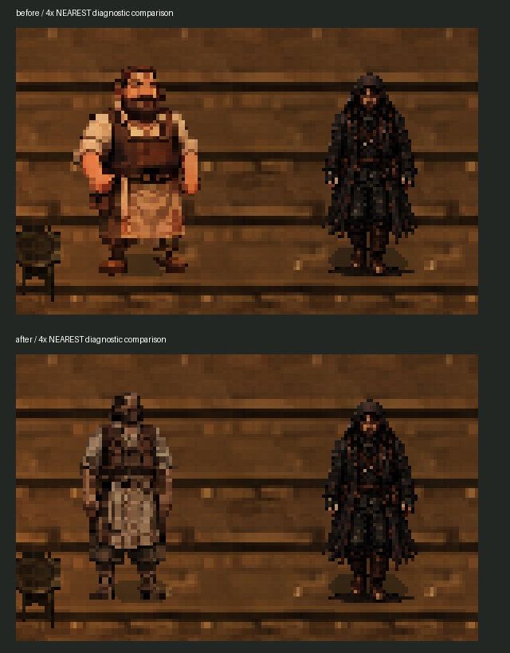
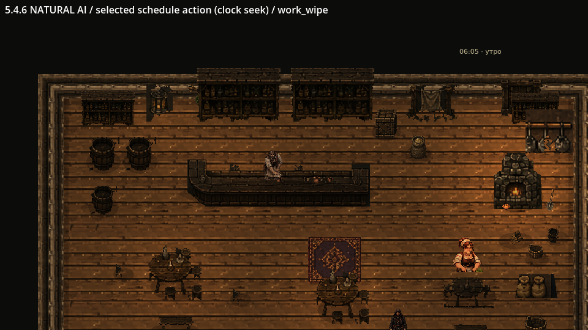
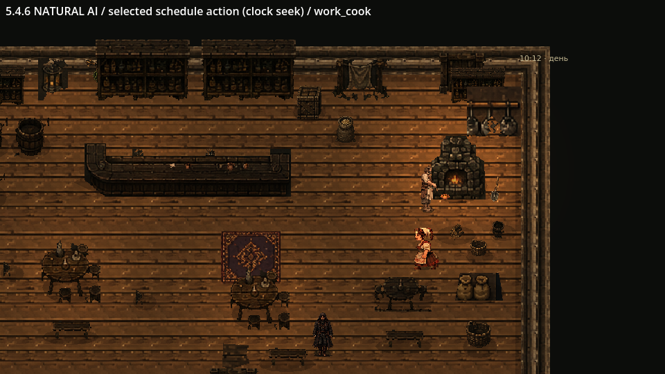

# Этап 5.4.6 — переработка трактирщика

Исходная основа реализации: `main` `08c9d04` после PR #26; первоначальный коммит PR #28 — `d174085`. Ветка: `codex/stage546-innkeeper`. Проверено 13 ноября 2026 года в **Godot 4.6.3 stable**, Linux, Compatibility/OpenGL, llvmpipe.

PR #28 синхронизирован с `main` `bc8bfaa`, куда уже вошёл PR #27. Конфликты общих подключений разрешены с сохранением сына дровосека и трактирщика. Актуальные результаты объединённой версии: [отчёт о разрешении конфликтов](PR28_CONFLICT_RESOLUTION.md). Ниже сохранён отчёт первоначальной реализации этапа 5.4.6 и её материалы.

## Результат

Подготовлены новая взрослая модель трактирщика, четырёхнаправленная ходьба, покой, работа с тряпкой, кружкой и кувшином, проверка еды у печи и портреты. Трактирщик физически перемещается между стойкой, припасами, печью и существующими точками. Во время разговора движение прекращается, завершается только постановка предмета/выпрямление, затем включается спокойный разговор.

Ганс, дровосек, его жена и сын, жена трактирщика и остальные жители не перерабатывались. Сохранены их графика, определения, диалоги и расписания. Общие часы, навигационный сервис, система переходов, звук, карты и другие интерьеры не изменялись.



## Графические материалы

Основной художественный референс — приложенный лист трактирщика. Это не готовый технический атлас: его подписи, фон, мебель и похожие позы не импортировались в игровые кадры.

По референсу генератором изображений подготовлены **новые рисованные позы**: мужчина около 45 лет, широкий корпус, умеренная полнота, тёмные волосы и борода, поношенная рубашка, кожаный жилет, пояс, льняной передник и сапоги. Ганс и обновлённый дровосек использованы для сравнения игрового роста и плотности деталей. Это не уменьшенная или перекрашенная модель другого NPC.

В `HutorReborn/assets/npc/innkeeper546/source/` сохранены исходники `idle`, `right`, `down`, `up`, `wipe`, `mug`, `pour`, `cook`, `social`, `portrait`, `props`, `crock`. Они отслеживаются Git, но исключены из игрового импорта через `.gdignore`. Старые ресурсы трактирщика сохранены на своих местах.

`tools/prepare_innkeeper_546.py` выполняет техническую обработку: очистку альфы и яркой краевой примеси, выделение фигур, равномерное масштабирование Nearest, сборку атласа, нарезку портретов и мелкой посуды. Программной анимации конечностей или растягивания отдельных частей тела нет. Для каждого листа применяется единый коэффициент; наклонённые позы не растягиваются до высоты стоящей фигуры.

- **62 уникальные нативные позы**, ячейки атласа 96 × 96, опора `(48, 82)`, смещение `(-48, -82)`.
- Рост стоящего персонажа — ориентировочно **51 игровой пиксель**, сопоставим с Гансом, при более широком корпусе. Масштаб узла `Vector2.ONE`.
- Бинарная альфа 0/255, прозрачный RGB обнулён, Nearest; нет подписей, рамок, соседних фигур и обрезанных частей тела.
- Собственный материал использует существующий шейдер палитры: насыщенность 0,8, экспозиция 0,96, баланс `(0.94, 0.97, 1)`. Материалы остальных персонажей не менялись.
- Четыре портрета 128 × 192: neutral, joy, displeased, anxious. Пропорции сохраняются при кадрировании; новый портрет отображается в существующем окне в нативном размере. В диалоговом JSON заменены только пути изображений — текст и варианты ответов сохранены.

## Анимации, которые действительно созданы

| Набор | Кадры | Применение |
|---|---:|---|
| `idle_down/up/right/left` | 2 | Спокойная поза и небольшое дыхание |
| `walk_down/up/right/left` | 6 | Контакт, опора и проходящая нога для обеих сторон |
| `work_wipe` | 8 | Подготовка, наклон, движения тряпкой, выпрямление |
| `work_mug` | 8 | Взять кружку, протереть, осмотреть, поставить |
| `work_serve` | 8 | Взять сосуды, наклонить кувшин, налить, поставить |
| `work_cook` | 8 | Достать ложку, проверить/помешать, осмотреть, убрать |
| `talk`, `talk_down` | 4 | Небольшие разговорные жесты |
| Боковой и тыльный разговор | 2 | Направленные спокойные позы |
| `work_rest`, `turn_*` | 2 / 1 | Отдых и короткое внимание к Гансу |

Левая ходьба отражает правую **один раз**. Из восьми исходных ходовых рисунков выбрано шесть: похожие фазы и чрезмерно высокий подъём колена не использованы для заполнения цикла. Частота ходьбы — 6 FPS при исходной скорости **28 пикселей/с**, с существующей зависимостью воспроизведения от фактической скорости. Постоянный бег не добавлен.

22 имени в SpriteFrames включают совместимые имена и направленные варианты; это не 22 независимых действия. Проверка уникальности рисунков не подменяет оценку анатомии.

[Нативные позы](deliverables/Stage546/Native-poses.png) · [Ходьба в четырёх направлениях, MP4](deliverables/Stage546/Walking-four-directions.mp4) · [Последовательные захваты движения](deliverables/Stage546/Walking-time-sequence.png)

## Работа и расписание

Сохранены дом `inn`, все временные границы блоков **00:00 / 06:00 / 10:00 / 18:00 / 22:00**, ночные точки и существующие точки прежних занятий. У остальных жителей расписания не менялись.

В рабочих блоках перераспределены минуты самого трактирщика, чтобы добавить короткую проверку печи и паузу за стойкой. Общая длительность повторяемого цикла сохранена: **18 минут утром, 20 днём, 19 вечером**.

| Исходное занятие / добавленная точка | Фактическое поведение |
|---|---|
| `prepare_inn` | Протирание стойки, выпрямление, пауза |
| `wipe_mug` | Протирание кружки и осмотр |
| `arrange_dishes` | Подготовка и наливание напитка из глиняного кувшина |
| `check_supplies`, `visit_tables` | Сохранённые перемещения к припасам и столам |
| `check_hearth` | Физический подход к печи, работа ложкой у небольшого горшка |
| `pause_counter` | Спокойная пауза, внимание к Гансу |

Рабочие клипы проигрываются однократно, между ними есть паузы разной длины. Обслуживание — подготовка напитка на стойке; новой системы заказов, денег или посетителей нет. Никто не телепортируется к печи. Работа не проигрывается, пока персонаж не достиг рабочей точки и рядом нет нужной поверхности/горшка.

При E движение блокирует существующая диалоговая система. Если в руках предмет, проигрываются только последние позы его постановки и выпрямления; протирание/наливание не продолжаются на фоне разговора. Затем трактирщик смотрит на Ганса. После закрытия разговора он возвращается к тому же занятию, начиная следующий короткий рабочий цикл. Предмет не рисуется одновременно в руках и на столешнице: настольный экземпляр появляется после освобождения рук.




## Изменения в трактире и точная привязка

Архитектура, размеры помещения, стойка как изображение, печь, мебель и основные проходы сохранены. Добавлены только пять небольших визуальных узлов:

- `Counter/MugWipe546`, `Counter/MugService546` — две рабочие кружки.
- `Counter/Pitcher546`, `Counter/Cloth546` — глиняный кувшин и тряпка.
- `Fireplace/CookingCrock546` — маленький горшок с едой у переднего левого края печи, нативная ширина 10 пикселей. Большого котла нет.

Первоначально проверенный ресурс `pot.png` оказался ведром и плохо читался в этой роли. Он не заменён и не удалён: для готовки создан отдельный подходящий глиняный горшок. Существующие подвесные сосуды и напольная утварь остались на месте. У новых мелких предметов нет отдельных напольных коллизий: они находятся на стойке/у печи и не образуют невидимые препятствия.

**Исправлена только коллизия основания стойки:** прямоугольник 226 × 30 со смещением `(0, -13)` заменён на 226 × 14 со смещением `(0, -7)`. Старое пятно занимало часть свободного пространства за столешницей и оставляло трактирщика слишком далеко от неё. Ширина стойки и её графика не менялись; основание по-прежнему непроходимо.

Общий навигационный bake не перестраивался. `innkeeper_actor_546.gd` только для трактирщика дополняет путь коротким последним подходом к задней рабочей кромке, около Y=240, с проверкой статических коллизий и обычным `move_and_slide()`. Сохраняется стандартный допуск достижения точки. При восстановлении ожидающего NPC после смены сцены подход выполняется повторно физически с сохранением оставшегося ожидания. Исходное определение NPC не мутирует.

**Ноги не сдвигаются ради картинки:** `sprite.position == Vector2.ZERO`, масштаб единичный, глобальный Z персонажа не повышается. Тело остаётся в обычном Y-sort. Во время работы отдельная верхняя часть того же кадра рисуется внутри узла стойки, чтобы руки/тряпка были над столешницей, а ноги оставались за мебелью. Этот слой не меняет порядок Ганса и других объектов мира.

## Проверки первоначальной реализации (до синхронизации с main)

Проверка выполнена на нескольких уровнях; успешный импорт не считается проверкой поведения.

| Проверка | Результат |
|---|---:|
| Импорт Godot 4.6.3 | Без ошибок загрузки и разбора скриптов |
| `verify_residents_546.gd`: все девять жителей, направления, масштабы, портреты, реальные диалоги | **316 / 316** |
| `verify_innkeeper_work_546.gd`: реальные рабочие точки, переходы, разговоры при каждом действии, повторный вход, посуда без дубликатов | **51 / 51** |
| `verify_innkeeper_counter_546.gd`: рабочая кромка, коллизии и пиксельное перекрытие | **8 / 8** |
| `verify_innkeeper_depth_546.gd`: перед/за домом, сосной, забором и Гансом | **8 / 8**, ошибочных пикселей 0 |
| `verify_door_transitions.gd` | **335 / 335** |
| `verify_daily_cycle.gd` | **33 / 33** |
| `verify_worker_speed.gd` | **11 / 11** |
| `verify_dialogue.gd` | **65 / 65** |
| `verify_innkeeper_sources_546.py` | **1444 старых файла неизменны**, проверены остальные восемь моделей/профилей/расписаний, границы суток, длительности циклов, исходники и альфа |

Пиксельный тест стойки подтверждает **0 неверных пикселей в зоне сапог** и **376 видимых пикселей верхнего рабочего слоя**. Дополнительно проверено: за стойкой свободно, основание твёрдое, передний проход для гостя свободен. [Измерения](deliverables/Stage546/counter.json), [Y-sort](deliverables/Stage546/depth.json).

**Графический просмотр.** Инструмент `review_innkeeper_546.gd` проверил сравнение с Гансом, физическую ходьбу во всех четырёх направлениях, непрерывный цикл AI между рабочими местами, разговор у стойки и печи и отображение вечером/ночью — **28 проверок**. Расстановка сравнения и диагностические проходы отмечены подписями; они не выдаются за свободную игру. Для наблюдения занятий часы временно зафиксированы.

Финальное расположение посуды отдельно просмотрено в `review_counter_546.gd`: **5 проверок**, четыре существующих занятия выбираются переводом тестовых часов, затем выполняются реальным AI. [Актуальная запись рабочих действий](deliverables/Stage546/Workstations.mp4). `review_hearth_546.gd` подтвердил три последовательных кадра ложки у видимого горшка; это вспомогательная проверка, а не доказательство анатомической идеальности.

**Обычный запуск с клавиатуры.** `native_innkeeper_546.py` управлял настоящим окном Godot через XTest: WASD к двери, E для входа, подход к трактирщику, E/Escape у стойки и печи, выход, повторный вход и выход. Телепортации Ганса и перевода часов в этом сеансе не было. Камера внутри была 1,3 и восстановилась снаружи. Сохранились Ганс и все девять ID жителей. [Протокол действий](deliverables/Stage546/native-native-actions.jsonl), [итоговое состояние](deliverables/Stage546/native-result.json), [разговор](deliverables/Stage546/native-counter-dialogue.png).

В проверенных игровых запусках не обнаружено ошибок GDScript, отсутствующих ресурсов, сбоев сцен или игровых исключений. У графического драйвера llvmpipe остаётся предупреждение о недоступном V-Sync. Графические записи проверены декодированием. Финальная корректировка размещения настольной посуды подтверждена отдельной актуальной записью рабочих мест.

## Ограничения и ручная приёмка

- Движение проверено последовательностями захватов во времени и записями, а не одним статичным кадром. Однако это не заключение профессионального аниматора и не гарантия полного отсутствия скольжения на любом диагональном маршруте. Нужно вручную просмотреть ноги, мах рук, передник и переходы в игровом окне при ×1.
- Ходьба имеет шесть отобранных фаз; независимой левой анатомической проекции нет. Слева зеркалятся пояс и складки передника. Боковой и тыльный разговор используют спокойные направленные позы, без отдельной артикуляции лица.
- Пальцы, струя напитка и содержимое кружки занимают единицы пикселей в игровом масштабе. Струя нарисована в кадрах, новой жидкости/физики напитков нет. Настольные предметы не являются инвентарём или системой обслуживания заказов.
- Верхний рабочий слой настроен на текущую стойку и проверенные фронтальные рабочие позы. При будущей замене стойки или изменении роста NPC его отсечение и положения посуды нужно проверить повторно.
- Непрерывный цикл AI, отдельные рабочие места и один обычный клавиатурный сеанс проверены. Многочасовая игра во всех сочетаниях тесных встреч NPC не проводилась. Вечер/ночь показаны диагностическим сравнением в существующем освещении, а не новым световым режимом.
- Художественные метаданные не объявляют модель окончательно одобренной. Финальная приёмка: сравнение с Гансом на целевом мониторе, четыре походки, касание тряпкой поверхности, кружка/кувшин при постановке, ложка у горшка и завершение разговора.

## Файлы и воспроизведение

Игровые файлы: новая папка `assets/npc/innkeeper546/`; `scenes/npc/residents/innkeeper.tscn`; `scripts/npc/rework/innkeeper_actor_546.gd`, `innkeeper_presentation_546.gd`; точечные подключения в `scripts/life/activity_presenter.gd`, `scripts/npc/visuals/visual_library.gd`, `scripts/npc/npc_animator.gd`; только расписание трактирщика в `data/life/residents/innkeeper.json`; его запись в `data/visuals/animation_catalog.json` и `residents.json`; портретные ссылки `dialogues/residents/innkeeper.json` и нативное размещение только этого портрета в `scripts/dialogue/dialogue_window.gd`; пять мелких предметов и коллизия стойки в `scenes/interiors/inn.tscn`.

Остальное — новые тесты `*_546`, инструменты `prepare_innkeeper_546.py`, `inspect_inn_546.gd`, `review_innkeeper_546.gd`, `review_counter_546.gd`, `review_hearth_546.gd`, `native_innkeeper_546.py`, UID/import-описания, этот отчёт и `deliverables/Stage546/`. Старые ресурсы не удалены.

Из `HutorReborn`:

```sh
godot --headless --editor --path . --import
godot --headless --fixed-fps 60 --path . --script res://tests/verify_innkeeper_work_546.gd
godot --path . --script res://tests/verify_innkeeper_counter_546.gd -- /tmp/counter546.json
godot --path . --script res://tools/review_counter_546.gd -- /tmp/inn546-workstations
python tests/verify_innkeeper_sources_546.py
```

Клавиатурный сеанс требует X11: сначала `python tools/native_window_playtest.py launch --output /tmp/inn546-native`, затем в другом терминале `python tools/native_innkeeper_546.py --output /tmp/inn546-native`. Для каждого запуска нужен новый каталог. Временный `override.cfg` удалён и в PR не включён.

**Отдельный PR в `main`; автоматическое объединение не выполняется.**
