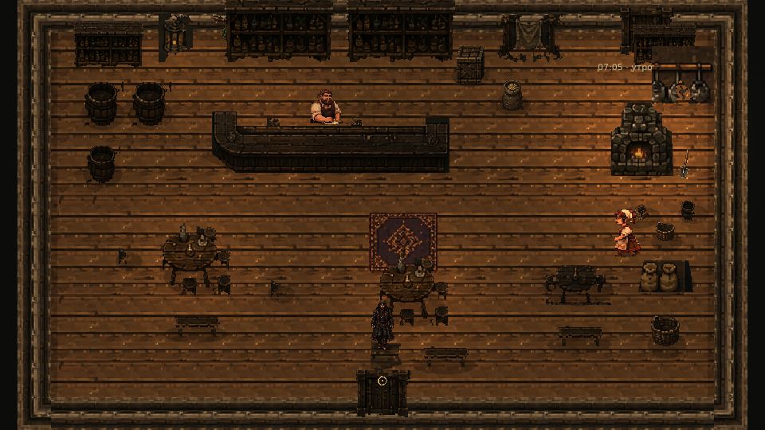
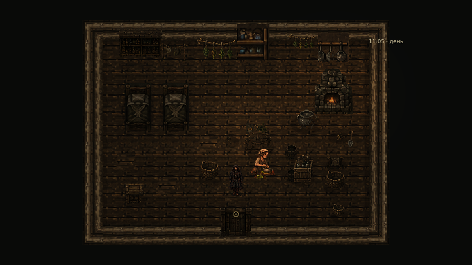

# Этап 5.4 — NPC: новые ресурсы и рабочие анимации

Дата: 11 ноября 2026. Основа: `main` / `457c1cf` (этап 5.3.2, PR #21). Ветка: `codex/stage54-npc-rework`. Движок проверки: Godot **4.6.3 stable official**, GDScript, Compatibility / Mesa llvmpipe.

## Результат и границы готовности

В игру подключены новые тела и портреты всех девяти существующих жителей, четыре направления ходьбы, направленный покой, разговоры и ряд индивидуальных действий у реальных рабочих мест. Сохранены девять исходных ID и экземпляров жителей, Ганс, карта, шесть интерьеров, двери, время, расписания, диалоговые графы и звук.

**Этап реализован частично по художественному качеству полного запрошенного набора.** Архив содержит оформленные иллюстративные листы, а не гарантированно согласованные циклы анимации. У некоторых фаз похожая постановка ног, различается анатомия и нет промежуточных поз. Обработка и дополнительные кадры значительно расширяют возможности, но не заменяют финальную работу пиксельного аниматора. Перенос груза в движении, полноценные повороты и часть занятий пока не готовы. Ниже подготовленные ресурсы отделены от реально подключённых действий.

## 1. Выполненные внутренние этапы

1. Изучены девять исходных листов, прежние визуальные ресурсы, реальные сцены, мебель, расписания и точки работ.
2. В отдельной папке сохранены оригиналы, подготовлена нарезка с ручными границами, очищена непрозрачная подложка и рамки.
3. Подключены новые SpriteFrames через существующую визуальную библиотеку. Исправлено двойное отражение родных кадров движения влево.
4. Добавлены индивидуальные рабочие клипы и дополнительные кадры там, где пригодных изображений не было.
5. Добавлен отдельный слой представления с проверкой состояния, расстояния до цели и наличия нужного предмета.
6. Добавлены небольшие предметы работы; геометрия сохранённых сцен не менялась.
7. Выполнены проверки ресурсов, диалогов, движения, переходов, суточного цикла, рабочих привязок и графические проверки.
8. Подготовлены этот отчёт, записи и изображения для ревью.

## 2. Источники и обработка

Все девять PNG из `Hutor_NPC_Characters_9.zip` сохранены отдельно и не перезаписаны:

- `HutorReborn/assets/npc/stage54/references/` — исходные листы 1536×1024.
- `.../generated_source/` — три дополнительных листа, созданных с опорой на утверждённую внешность.
- `.../game/<npc_id>/` — игровые RGBA-атласы, SpriteFrames, четыре портрета.
- `.../manifest.json` — SHA-256 оригиналов, исходные прямоугольники, масштаб и смещение каждого полученного кадра, ограничения.

В authoring-папках есть `.gdignore`: высокие исходные листы хранятся в Git, но не загружаются движком как игровые текстуры. Старые ресурсы сохранены.

Подготовлено **541 отдельное изображение в девяти атласах**, включая рабочие позы; это не 541 независимая анимация. Имена некоторых клипов ссылаются на те же кадры. Дополнительно подготовлены 36 портретов 128×192 и два маленьких предмета. Номера кадров считаются по реально найденным рисункам: например, у ребёнка в нескольких рядах четыре рисунка, несмотря на подпись «6 кадров».

Техническая обработка: выделение связанного с границами фона, очистка разделителей, ручные границы рядов и крайних ячеек, двоичная альфа, пропорциональная Nearest-передискретизация. В последнем проходе отдельно проверены крайние кадры: именно в них оставались углы рамок. Палитра исходных видимых пикселей не перекрашивалась. Непрозрачная подложка превращена в прозрачность; исходная альфа художественного листа не считается готовой маской персонажа.

Дополнительные кадры созданы инструментом генерации изображений и затем технически нарезаны:

- `child_run_vertical.png`: четыре фазы бега к зрителю и четыре от зрителя.
- `sweeping_women.png`: по четыре фазы подметания двух разных женщин.
- `read_and_cook.png`: четыре полноростовых кадра старосты со свитком и четыре кадра жены дровосека с небольшой миской.

Первый вариант детского бега отклонён: во всех позах ведущая нога оставалась почти одинаковой. Он не включён в игру и PR. Принятые дополнительные листы тоже требуют окончательной художественной сверки костюма и переходов с исходной ходьбой.

Воспроизведение обработки (Pillow, numpy, scipy):

```sh
python HutorReborn/tools/prepare_npc_rework.py --preview /tmp/npc54-contact.png
```

## 3. Общий технический стандарт

- Ячейка 96×96, опора ног `(48, 82)`, существующее смещение AnimatedSprite2D `(-48, -82)`.
- Масштаб игрового NPC остаётся `(1, 1)`, без вращения или отдельного растяжения осей.
- Ориентиры высоты: староста 48 px, трактирщик 50, его жена 47, дровосек 48, его жена 46, мальчик 33, травница 47, брат 49, старик 44. Ракурсы согласованы по высоте; естественное сгибание и сидячие позы ниже.
- У всех есть `walk_down/up/left/right` по 8 исходных рисунков, `idle_down` — 4 рисунка (у жены трактирщика 3), `talk` — 4.
- `idle_up/left/right`, `turn_*` — честные одиночные направленные позы. Это не новые анимированные повороты или дыхание.
- `talk_down/right` используют имеющиеся фронтальные/трёхчетвертные рисунки; `talk_left` отражён. Для разговора спиной используется статичная направленная поза, поскольку полноценного заднего talk нет.
- Ходьба влево берётся из отдельного исходного ряда; повторное зеркалирование отключено метаданными. Только детский `run_left` зеркалит `run_right`.
- Сохранено перенесение фазы при смене направления. FPS ходьбы рассчитывается по исходной скорости и росту; существующее масштабирование по фактической скорости сохраняется. Бег мальчика: вертикальные 4 кадра × 8 FPS, боковые 8 × 16 FPS — одинаковая длительность цикла.
- Фильтрация тела и портретов Nearest. Реальная коллизия ног и навигация не заменены границами картинок.

## 4. Все девять жителей: ресурсы и доступность

Число после действия — количество подготовленных кадров. «Ресурс» означает, что клип загружается и доступен для просмотра; это не утверждение, что расписание использует его в игре.

| Житель / ID | Действия, подключённые к существующим занятиям | Подготовлено отдельно / ограничения |
|---|---|---|
| Дровосек / `woodcutter` | Новые ходьба, покой, разговор; существующие уход, отдых и возвращение | Рубка 6, пила 6 — ресурсы. Лесоповал остаётся прежней виртуальной работой за картой. Подъём и перенос поленьев в движении не созданы |
| Жена дровосека / `woodcutter_wife` | Подметание 4, стирка 6, приготовление пищи с миской 4 у кухонной зоны | Садовые работы пока показывают покой; нет ходьбы с корзиной. В стирке часть утвари включена в исходный рисунок |
| Сын / `woodcutter_son` | Четырёхнаправленный бег, игра с палкой 4, приседание/рассматривание 4, разговор; прежние игровые маршруты и визиты к матери | Игра с мячом 4 подготовлена отдельным клипом; не добавлен новый пункт расписания. Вертикальному бегу нужны дополнительные промежуточные фазы |
| Трактирщик / `innkeeper` | Протирание 6 у Counter, подача посуды/кружки 6 у Counter, разговор | Поднос 6 — ресурс; нет доставки подноса во время ходьбы. Кран и котёл не добавлялись, их анимации не использованы |
| Жена трактирщика / `innkeeper_wife` | Протирание 6 у TableA, кухонная подготовка 6 у TableC, подметание 4 | Расстановка посуды 6 и поднос 6 — ресурсы. Работает отдельно от мужа, у своих поверхностей |
| Староста / `elder` | Чтение полного тела 4 у Desk, периодическая запись 6 за Desk, разговор/жесты | Исходное чтение 6 и жест 6 с обрезанным низом подготовлены, но не показываются посреди комнаты. Полноценного перехода «сесть/встать» нет |
| Старик / `old_man` | Курение 6, сидячий отдых с трубкой 6, рассказ/жесты 6; существующий лёгкий дым с учётом отражения позы | Резьба 6 — ресурс; часть сидячего рисунка содержит полено. Нет полного цикла посадки/вставания |
| Травница / `herbalist` | Сбор 6 у растений, измельчение/подготовка 6 у реального Table | Сушка 3 и упаковка 3 — ресурсы, сушка в расписании пока остаётся покоем. `brew` показывает подготовку трав, а не варку в несуществующем котле. Исходная ступка содержит часть маленькой подставки |
| Брат травницы / `herbalist_brother` | Домашняя работа с инструментом 6, ходьба, разговор; сохранён прежний выход на лесоповал | Рубка 6, сбор хвороста 6 — ресурсы. Перенос груза в движении не создан. Нового леса нет |

## 5. Рабочие места и небольшие предметы

Рабочий клип запускается при WAITING, локальном занятии, прибытии ближе 12 px к текущей безопасной цели и выполнении привязки. Если нужна мебель, проверяются существующий узел и допустимое расстояние. При уходе, разговоре, визуальном взгляде на Ганса или потере предмета действие уступает подходящей позе. Представление не перемещает физическое тело; небольшой наклон изображения к поверхности сглаживается.

У жены трактирщика выровнены локальные рабочие цели относительно TableA / TableC, у травницы — относительно Table. Имена действий, время, длительность и межсценовые назначения в JSON не менялись. Это точечная поправка позиции у мебели в памяти, используемая одинаково локальным и виртуальным представлением.

Полуторсы трактирщиков и запись старосты разрешены только у мебели и рисуются над рабочей поверхностью. Для отдельно загруженного NPC без суточного presenter такие рабочие позы блокируются. Прежнее скрытие большого стола травницы больше не применяется к новым клипам.

Мелкие предметы создаются в `Actors/NpcWorkProps54` с Y-sort и повторно используются: таз из исходного листа, маленький мяч, существующие травы, маленькая скамья и пенёк. Максимум 24 объекта на сцену. Использованы прежние текстуры `stage44/herbs.png`, `stage44/bench.png`, `krivaya_sosna/objects/stump.png`; новые технические вырезки лежат в `game/props/`.

Эти небольшие декоративные предметы не имеют новых твёрдых коллизий и не перекрывают маршруты. Новая крупная мебель не добавлялась. У ряда исходных рабочих рисунков уже есть утварь, полено или растения; точное отделение этих предметов от тела и полная согласованность с отдельной декорацией остаются художественным ограничением. Привязка по расстоянию не является полноценным IK или симуляцией контакта кисти с предметом.

## 6. Изменённые файлы

Сохранённые `.tscn` **не менялись**. Не менялись Ганс, исходные изображения, сцены карты и комнат, project.godot, коллизии помещений, двери, камера, система диалогового окна, игровые тексты, расписания и аудиосистема.

Изменены:

- `scripts/npc/visuals/visual_library.gd` — выбор нового набора с прежним fallback.
- `scripts/npc/npc.gd` — подключение новых кадров и безопасный отдельный просмотр без неподходящего рабочего торса.
- `scripts/npc/npc_animator.gd` — учёт родных левых кадров.
- `scripts/life/activity_presenter.gd` — подключение нового представления.
- `scripts/life/village_life.gd` — три места использования выровненной рабочей точки.
- `data/visuals/{residents,animation_catalog,missing_art}.json` — активные ресурсы и честные ограничения.
- Девять `dialogues/residents/*.json` — **только пути портретов**. Тексты, ответы, ID, условия и связи неизменны; это проверено сравнением структур.

Добавлены:

- `assets/npc/stage54/` — оригиналы, дополнительные исходники, атласы, портреты, предметы, SpriteFrames, метаданные и импорты игровых ресурсов.
- `scripts/npc/rework/{work_bindings,resident_presentation}.gd` (+ UID).
- `tools/{prepare_npc_rework.py,review_npc_rework.gd}` (+ UID).
- `tests/verify_npc_rework.gd`, `verify_npc_work_bindings.gd`, `verify_npc_rework_sources.py` (+ UID для GDScript).
- Этот отчёт и `deliverables/Stage54/`.

## 7. Проверки

Результаты и журналы находятся в [deliverables/Stage54/checks](deliverables/Stage54/checks/).

| Проверка | Результат | Что подтверждено |
|---|---|---|
| Импорт / загрузка GDScript Godot 4.6.3 | Пройдено | Новые ресурсы и скрипты загружаются |
| `verify_npc_rework` | 316 / 0 ошибок | Все 9 ID, родные направления, новый набор, Nearest, оригинальные E-разговоры, 36 портретов, пауза и возобновление занятий, отсутствие дубликатов |
| `verify_npc_work_bindings` | 121 / 0 | 14 конкретных занятий; привязка, запрет работы вдали/без мебели, повторное использование предметов, разговор; чтение/запись старосты |
| `verify_npc_rework_sources.py` | 440 контрактов | Защищённые прежние файлы, SHA источников, RGBA, границы атласа, реально разные рисунки ходьбы, неизменность диалоговых графов |
| `verify_door_transitions` | 335 / 0 | Все 6 домов, реальные смены сцен, состояние Ганса, камера, выходы |
| `verify_stage51` | 706 / 0 | Шесть прежних комнат, физическая проходимость точек, мебель, маркеры, идентичность жителей |
| `verify_daily_cycle` | 33 / 0 | Утро/день/вечер/ночь, деятельность девяти жителей, физический уход обоих работников и возвращение, ребёнок |
| `verify_child_play` | 7 / 0 | Игра, безопасные маршруты, возвращение домой |
| `verify_dialogue` | 65 / 0 | Прежние ветвления, ответы, блокировки ввода, отмена и освобождение окна |
| `verify_worker_speed` | 11 / 0 | Скорости работников и физический выход за границу |
| `verify_resident_depth` | 24 / 0 | Растровая проверка Y-sort трёх жителей перед/за домом, сосной, забором и Гансом |
| `verify_ambient` | 183 / 0 | Сохранённые атмосферные системы |

Успешные числовые проверки не означают художественно идеальную походку. Старый тест `verify_expressive_residents` сравнивает тело с прежними изображениями и требует однокадровый фронтальный idle; новый набор намеренно меняет этот контракт. Вместо ослабления старого теста добавлен отдельный `verify_npc_rework`. Аналогично прежние тесты с жёстко заданным старым FPS не используются как доказательство новой анимации.

В повторном запуске изолированного `verify_dialogue` после успешных 65 проверок отмечено предупреждение об одном ресурсе/ObjectDB при завершении тестового процесса. Это не ошибка парсинга и не наблюдавшийся сбой игрового разговора; журнал сохранён, отсутствие абсолютно всех предупреждений не заявляется. В графическом игровом запуске ошибок GDScript не обнаружено. Mesa сообщает о неподдерживаемом переключении VSync. Звуковой вывод в графических тестах Dummy; звучание на устройстве этим не подтверждено.

### Фактическое графическое тестирование

- Обычный запуск настроенной главной сцены, X11, ввод настоящими событиями клавиатуры ОС: движение Ганса, подход к дверям, E, движение внутри, выход из всех шести домов; ребёнок замечен в состоянии движения с `run_*` при времени ×1. Отладочный observer только читает состояние, не телепортирует актёров. Временный override удалён.
- Отдельный диагностический стенд показывает новые ресурсы всех девяти жителей во времени: четыре направления, Idle/Walk и подготовленные рабочие клипы. Это **не запись их самостоятельного поведения в деревне**.
- Проверки рабочих мест используют настоящие комнаты и существующих жителей, но диагностически ставят их в заданные точки занятий. Это подтверждает отрисовку/привязку, а не самостоятельное прохождение к каждой работе.
- Просмотрены кадры записей с интервалами во времени, крайние кадры рядов и увеличенные контакты спрайтов. Нет основания объявлять всю анимацию анатомически безупречной или полностью исключить скольжение у всех фаз.
- Нативная прогулка и рабочие снимки сделаны до заключительной технической очистки крайних кадров и выравнивания масштаба ракурсов; итоговый стенд ресурсов записан после неё. Планировка и рабочие привязки между этими запусками не менялись.
- Проверка выполнялась на программном GPU. Это не измерение целевых 60 FPS на оборудовании игрока.

## 8. Визуальные доказательства

- [Запись итоговых ресурсов во времени, 2× Nearest](deliverables/Stage54/npc-resource-playback.mp4).
- [Диагностическая запись рабочих привязок](deliverables/Stage54/work-binding-diagnostic.mp4).
- [Обычная игра: шесть домов и бег ребёнка](deliverables/Stage54/native/), включая `native-actions.jsonl` и `complete.json`.
- [Рабочие места в реальных сценах](deliverables/Stage54/work/).
- [Выборка движения из итоговой записи](deliverables/Stage54/motion-samples.png).
- [Контакт итоговой нарезки](deliverables/Stage54/npc-contact.png).

Примеры:





## 9. Что осталось сделать

1. **Художественная доработка походок:** согласовать постановку ног, перенос веса, длину шага и циклический стык для всех девяти листов. Особенно близки между собой некоторые женские боковые фазы. Разное число уникальных картинок не доказывает правильный цикл.
2. Нарисовать полноценные боковые/задние Idle и Talk, промежуточные повороты, вход/выход из рабочих поз, посадку и вставание. Сейчас смена разных поз заметна, хотя физического телепорта нет.
3. Доработать костюм и промежуточные вертикальные фазы нового детского бега; проверить темп при длительном ручном наблюдении.
4. Добавить настоящую ходьбу с поленьями, корзиной и подносом, подъём/опускание груза, усталость. Подмены обычной ходьбы такими действиями сейчас нет.
5. Отделить от тела встроенную утварь, подставки, сиденья и растения в рабочих рисунках. Для сушки трав и садовой работы пока выбран безопасный покой.
6. Проверить руками все контакты рабочих поз с мебелью, в том числе переходы между состояниями и перекрытие Гансом при тесном проходе. Привязка и запрет «работать в воздухе» проверены; точный контакт каждого пальца с предметом не заявляется.
7. Разобрать предупреждение освобождения ресурса в изолированном тесте диалогов; проверить производительность на целевом GPU и реальный звук.

## 10. Ручная проверка в Godot

1. Открыть `HutorReborn/project.godot` в Godot 4.6, запустить F6/F5 по обычному сценарию проекта. Не запускать авторский PNG как фон сцены.
2. Обойти жителей, наблюдать минимум по нескольку циклов в каждом направлении, включая диагональные смены направления; сравнить ноги с Гансом и плоскостью земли.
3. Войти/выйти через E во все шесть домов. В трактире наблюдать Counter, TableA и TableC; поверхности супругов должны быть раздельными. Проверить обход движущихся NPC.
4. В доме старосты наблюдать чтение и запись около 16 секунд; у травницы — подготовку трав у Table; в семье дровосека — готовку и игру мальчика. Посмотреть дворовые занятия, трубку и небольшой дым.
5. Во время занятия поговорить через E, проверить портрет и ответы, закрыть разговор и убедиться, что NPC продолжает занятие/маршрут. Не должно появляться второго экземпляра жителя.
6. Наблюдать день, уход работников и вечернее возвращение. F7 ускоряет прежнее время; оценку походки и темпа проводить прежде всего при ×1.
7. Для отдельного просмотра кадров: `godot --path HutorReborn --script res://tools/review_npc_rework.gd`. На стенде подготовленные клипы показываются без реальной мебели; обрезанные рабочие торсы там не следует трактовать как разрешение показывать их посреди комнаты.

PR не объединять автоматически. Для художественного принятия требуется ручной просмотр описанных ограничений.
