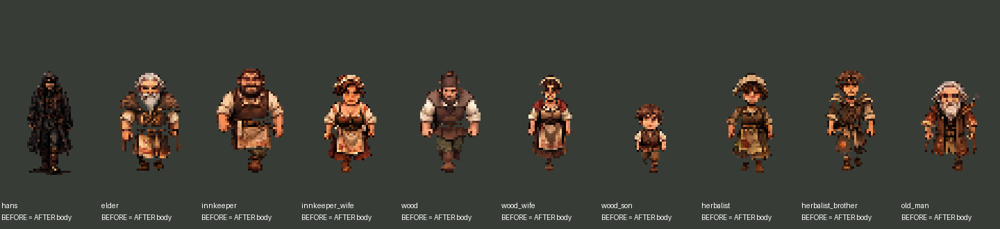
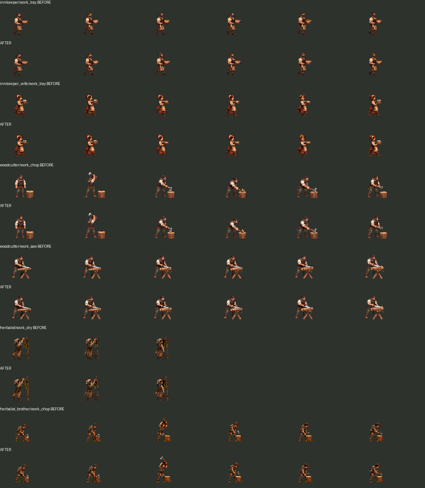

# NPC_VISUAL_FIX_5_4_1 — техническая коррекция и требования к перерисовке

Дата: 11 ноября 2026. Основа: `main` / `a4fccc2`, включающий объединённый PR #22. Ветка: `codex/stage541-npc-visual-correction`. Зависимости от неслитого PR нет.

## Статус: художественные критерии этапа не достигнуты

Исправлены подтверждённые ошибки представления: сброс рабочей фазы после разговора, дрейф опоры полноростового спрайта после работы, перенос рабочего смещения/слоя между сценами и избыточная частота переступания при медленном подходе. Перенарезаны 33 существующих рабочих изображения с обрезанными краями.

**Анатомия девяти основных моделей и последовательности ходьбы не переработаны.** Высота/ширина спрайтов, масштаб узлов, скорость движения и FPS ресурсов не изменялись. Утверждать, что теперь NPC полностью соответствуют Гансу, походки естественны, а все сложные действия имеют подготовку и завершение, было бы неверно. Выполнена техническая часть и предусмотренный пунктом 11 задания вариант результата при ограничениях художественных средств: измерения, исправления без деформации и точное ТЗ на недостающие кадры.

## 1. Измерение эталона и девяти жителей

Изучены реальные `scenes/player/hans.tscn`, `scripts/player.gd`, `assets/characters/hans/slicing.json`, `hans_frames.tres` и игровые PNG. У Ганса холст 960×1344, опора `(480,1280)`, ходьба отображается равномерно с `scale = 1/24`, боковой покой — `1/21`. Смещение `(-480,-1280)`. Скорость 94 единицы/сек; Walk Down/Up — по 6 кадров и 8 FPS, Left/Right — по 8 и 10 FPS. Left зеркалит Right; исходные параметры Ганса сохранены целиком.

У NPC холст 96×96, опора `(48,82)`, смещение `(-48,-82)`, узел `(1,1)`. Во всех случаях опора переходит в локальное `(0,0)` тела CharacterBody2D. Реальная коллизия ног остаётся прежней.

Таблица относится к репрезентативному `walk_down/0`. **До и после значения одинаковы**: это измерение, а не заявление об исправлении анатомии. Альфа-габариты измерены программно; у Ганса они включают авторскую небольшую тень. Ширина торса — ширина видимого силуэта в выбранной полосе, включая руки/одежду. «Голова» — ограничивающий размер внутри вручную отмеченной головной области, включая головной убор; это визуальный ориентир, а не точное измерение черепа. Положение таза скрыто одеждой и оценено вручную, поэтому длина ног приведена **приблизительно**, с погрешностью около ±3 игровых пикселей. Точная анатомическая длина под платьем/кафтаном из этих PNG не определяется.

| Персонаж | Высота / ширина альфа, px | Ширина торса с руками, px | Голова с убором, px (±1) | Таз–опора, px (≈±3) | Scale | Pivot исходника |
|---|---|---|---|---|---|---|
| hans | 49.46 / 22.83 | 22 | 12 × 12 | ≈19 | 0.04167 | [480, 1280] |
| elder | 47.0 / 29.0 | 29 | 17 × 14 | ≈17 | 1.00000 | [48, 82] |
| innkeeper | 50.0 / 32.0 | 32 | 16 × 14 | ≈18 | 1.00000 | [48, 82] |
| innkeeper_wife | 47.0 / 25.0 | 25 | 15 × 14 | ≈18 | 1.00000 | [48, 82] |
| woodcutter | 49.0 / 29.0 | 29 | 16 × 16 | ≈19 | 1.00000 | [48, 82] |
| woodcutter_wife | 46.0 / 21.0 | 21 | 13 × 13 | ≈19 | 1.00000 | [48, 82] |
| woodcutter_son | 33.0 / 15.0 | 15 | 10 × 12 | ≈12 | 1.00000 | [48, 82] |
| herbalist | 48.0 / 23.0 | 22 | 16 × 16 | ≈18 | 1.00000 | [48, 82] |
| herbalist_brother | 48.0 / 24.0 | 24 | 17 × 15 | ≈19 | 1.00000 | [48, 82] |
| old_man | 43.0 / 28.0 | 27 | 18 × 16 | ≈16 | 1.00000 | [48, 82] |

Воспроизводимость: `tools/measure_npc_proportions.py`; исходные ROI, оценки таза и измерения записаны в [measurements.json](deliverables/Stage541/measurements/measurements.json). Для каждого персонажа есть отдельное изображение с отмеченными областями. Все изображения сравнений используют одинаковое увеличение Nearest, без отдельного растяжения NPC.

Сопоставление подтверждает, что свести проблему к общей высоте нельзя: например, головной силуэт травницы и дровосека крупнее относительно их роста, а старик и староста заметно шире Ганса. Полнота трактирщика, мускулатура дровосека и сутулость старика допустимы, но должны быть согласованы анатомически. Одинаковое уменьшение всей фигуры уменьшило бы её рост и не исправило отношения частей тела. Поэтому такого «исправления» нет.

**Перечень исправленных анатомических пропорций: отсутствует.** Нужна перерисовка, а не изменение Scale или деформация отдельных областей. Техническая точка опоры и её восстановление исправлены отдельно от анатомии.

## 2. Точные технические причины и исправления

| Причина в PR #22 | Исправление | Предел результата |
|---|---|---|
| `npc_animator.gd` сохранял фазу только при Walk/Run → Walk/Run; возвращение Talk → Work всегда начиналось с кадра 0 | Сохраняются кадр и прогресс рабочего клипа, отдельно для текущих сцены/блока/шага. Новый контекст очищает сохранение, в том числе при том же имени клипа | Сохраняется ход рабочего движения; это не дорисованная фаза перехода Talk → Work |
| `resident_presentation.gd` плавно возвращал `sprite.position` из рабочей поправки, уже показывая полное тело | При полноростовых Idle/Talk/Walk сразу восстанавливается исходная опора. Сглаживание сохранено только для рабочей позы | Устранено скольжение целого стоящего спрайта; различие исходных поз головы/рук остаётся |
| `clear_props()` при парковке тела не сбрасывал рабочий visual offset, z-index и дым | `release()` очищает их и рабочий курсор перед дальнейшей материализацией | Не меняются физическое положение, расписание или сцены |
| `activity_presenter.gd` ограничивал скорость Walk снизу значением 0.35 даже при скорости тела 0.1 от номинала | При медленном прибытии speed_scale пропорционален реальной скорости, без этого нижнего порога | Базовые FPS и скорость перемещения не увеличены; это не исправляет недостаточные фазы источника |
| Ветвь визуального взгляда была выше выбора движения | Действительное движение имеет приоритет; взгляд разрешён ожидающему NPC | Защитное исправление порядка; текущие источники взглядов уже проверяли WAITING, поэтому оно не объявляется доказанной основной причиной прежней походки |
| Технические прямоугольники ряда рабочих клипов касались волос, топора и стойки для трав | Расширены вручную проверенные границы, сохранены прежний равномерный коэффициент и опора; центр не пересчитывается по поднятому топору | Только восстановление существовавших пикселей, без создания новых фаз |

Ключ контекста включает сцену, `block_stamp`, индекс шага и его имя. Курсор не переносится в другое занятие или здание. При разговоре управление разговором остаётся у существующих NPC/DialogueManager. Нового автомата поведения нет.

## 3. Переработанные кадры

Создана отдельная папка `assets/npc/stage541/`; ресурсы PR #22 сохранены. Визуальная библиотека выбирает коррекцию, затем прежний набор как fallback. Метаданные `rework_version=54` сохранены для совместимости, добавлен `correction_version=541`.

| Персонаж | Клип | Кадры | Исправление нарезки |
|---|---|---:|---|
| Дровосек | work_chop | 6 | Запас над поднятым топором и у нижнего края |
| Дровосек | work_saw | 6 | Восстановлен верх волос у границы ряда |
| Брат травницы | work_chop | 6 | Раскрыта верхняя часть замаха, включая лезвие; подпись первых двух ячеек исключена отдельно |
| Трактирщик | work_tray | 6 | Дополнительное пространство над волосами |
| Жена трактирщика | work_tray | 6 | Дополнительное пространство над причёской/платком |
| Травница | work_dry | 3 | Раскрыт верх стойки/трав |
| **Итого** | | **33** | Новых рисованных фаз: **0** |

`corrections.json` содержит старые/новые исходные прямоугольники, номера текстур, прежний коэффициент масштаба и SHA исходника. Применяется единое преобразование Nearest по обеим осям. Размер ячейки достаточен для этих восстановленных инструментов; границы конечного холста проверены.

Нарезка не добавляет отсутствующие стадии «взять топор», «положить груз», «встать с сиденья». Подготовленные клипы переноски/рубки не подключены к новым занятиям: лесоповал остаётся прежней виртуальной работой, как в PR #22.

## 4. Проверка всех девяти и недостающие кадры

У каждого просмотрены четыре направления и Idle во времени в Godot. У каждого проверено восстановление собственного рабочего кадра после Talk. Ни один житель не объявляется художественно принятым только по этому тесту.

| NPC | Что подтверждено | Что необходимо нарисовать/переработать |
|---|---|---|
| Дровосек | Новый ресурс подключён, рабочий курсор, более полная нарезка рубки/пилы | Реалистичная анатомия, тяжёлый полный шаг; взятие/замах/удар/отдача/возврат; подъём и перенос поленьев |
| Жена дровосека | Совместимость готовки, стирки, подметания и разговора; опора без послерабочего дрейфа | Нейтральные направленные позы, полноценные переходы бытовых действий и ходьба с корзиной; отделение таза/белья от тела |
| Мальчик | Ходьба/бег, игра и приседание остаются; настоящий бег наблюдался при ×1 | Дополнительные согласованные фазы детского бега, вставание из приседа, окончания игры и смены стойки; не взрослая походка в уменьшении |
| Трактирщик | Работа у Counter, возобновление, запас сверху в подносе | Полный стоящий силуэт у стойки; взять/протереть/подать кружку, доставить поднос; широкая взрослая анатомия |
| Жена трактирщика | Её отдельные поверхности сохранены; проверена голова в подносе | Полные позы у TableA/TableC, расстановка и перенос посуды, начала/концы подметания; энергичная взрослая походка |
| Староста | Чтение/запись и их курсоры, разговор | Полное тело за Desk вместо исходного торса, промежуточные жесты и повороты, спокойный шаг без смены размеров |
| Старик | Сохранены курение/отдых/разговор, сброс дыма при переносе | Сесть/встать, полное медленное переступание; дым отдельным слоем вместо фрагментов запечённого облака, законченная резьба |
| Травница | Молодой образ и бедная одежда сохранены, рабочая точка прежняя, верх стойки раскрыт | Перерисовка анатомии и всех фаз шага, полный сбор/измельчение/сушка без встроенной мебели, начало и конец работы |
| Брат травницы | Тощий образ и выходы на работу сохранены; возвращено лезвие замаха | Уставшая взрослая походка, полный цикл рубки, работа/перенос хвороста и инструмента, переходы к отдыху |

Для всех девяти дополнительно нужны согласованные направленные Idle/Talk и короткие переходные позы. Существующие боковые/задние Idle из остановленного шага и статичный Talk Up остаются ограничением; это не полноценная анимация покоя. У некоторых исходных рабочих кадров есть встроенные подставки, брёвна, растения или обрезанный низ. Они по-прежнему допустимы только в ограниченном контексте; полная отделимость тела от предмета не достигнута.

Машинное ТЗ по каждому ID: [ART_REQUIREMENTS.json](HutorReborn/assets/npc/stage541/ART_REQUIREMENTS.json). В нём перечислены фактические имеющиеся клипы и требуемые действия.

Требования к следующему комплекту художника:

1. Использовать неизменённого Ганса и приложенные сравнения на игровом масштабе; отдельно утвердить нейтральные силуэты девяти жителей до изготовления циклов. Измеренные головные области включают одежду и не заменяют анатомическую проверку.
2. Для каждой Walk Down/Up/Left/Right показать реальные контакты левой и правой стопы, перенос веса и проход ноги: left contact → left down → right passing → right contact → right down → left passing. Обычно 6–8 осмысленных фаз; точное число не является самостоятельным критерием качества.
3. Сохранять форму головы, плеч, таза, одежды и сумок между фазами. Ассиметричные предметы учитывать в противоположных направлениях. Не заполнять лист копиями одного контакта.
4. Передать Work как подготовка/основной цикл/завершение. Положение кистей и инструмента согласовать с существующей стойкой/столом и логикой работы. Для сидения нужны посадка и вставание.
5. Хранить полное тело и отдельные предметы/дым, прозрачный RGBA без подписей и рамок, одинаковую опору. Для большого замаха увеличивать поля холста с сохранением опоры, а не обрезать инструмент. Никакого независимого растяжения осей.
6. Проверять петлю и переходы в Godot при неизменной скорости каждого NPC и ×1 игрового времени; оценивать посадку стопы в движении, а не только отдельный PNG.

### Пробная художественная переработка

Создан пробный новый лист травницы по Гансу и утверждённому образу. Он **отклонён и не используется ресурсами игры**: достоверная последовательность противоположных контактов не подтверждается, несколько фаз слишком близки, стиль и края требуют дополнительной работы. Одна удачная статичная фигура не считается готовым циклом.

[Миниатюра отклонённого листа](deliverables/Stage541/rejected-trial.png) сохранена как объяснение ограничения. Доступными средствами в этой работе не получен согласованный художественно приемлемый набор для девяти жителей. Масштабированием или частотой воспроизведения этот недостаток не скрыт.

## 5. Реальные сцены и визуальные доказательства

- [Девять сравнений NPC с Гансом в существующих комнатах](deliverables/Stage541/rooms/). В кадрах подписано: диагностическая постановка, физика приостановлена, анатомия не изменена. Это существующие тела, без добавления жителей и без сохранения изменений сцен.
- [Диагностический просмотр четырёх направлений в комнатах](deliverables/Stage541/rooms-diagnostic.mp4). Это воспроизведение на месте, **не проверка отсутствия скольжения на самостоятельном маршруте**.
- [Ресурсы всех девяти во времени, 2× Nearest](deliverables/Stage541/resources-diagnostic.mp4), включая рабочие клипы. Отдельный стенд, не игровой рабочий процесс.
- [Обычная игра с клавиатурой ОС, шесть домов](deliverables/Stage541/native/native-six-houses.mp4), [журнал](deliverables/Stage541/native/native-actions.jsonl), [итог](deliverables/Stage541/native/complete.json). Запускается штатная главная сцена; observer только читает состояние. Пройдены входы, движение внутри и выходы, наблюдался бег мальчика при ×1. Склад проверен в обычном обходе; постоянного NPC там по прежней архитектуре нет.

На записи и в снимках проверены соотношения со столами, дверями, кроватями и стульями. Они показывают оставшееся различие стилей и не используются как доказательство законченной перерисовки. При просмотре движения оценены последовательные кадры записей; полная покадровая художественная приёмка всех движений не выполнена. [Выборка последовательных моментов](deliverables/Stage541/motion-samples.png) помогает найти нужные участки записи.

## 6. Проверки и ограничения результатов

Godot **4.6.3 stable official**, Compatibility, X11 / Mesa llvmpipe. Журналы: [checks](deliverables/Stage541/checks/).

| Проверка | Результат |
|---|---|
| Импорт проекта и GDScript | Без ошибок парсинга/загрузки новых ресурсов |
| `verify_npc_corrections` | 65 успешных: все 9 ресурсов, 4 направления, возобновление Work у каждого, сброс контекста, сохранение фазы направления, малая скорость, опора, очистка слоя/дыма и неизменная скорость тела |
| `verify_npc_correction_sources.py` | 502 контракта неизменности защищённых файлов и объёма перенарезки: ровно 33 допустимых кадра, остальные ячейки неизменны; порядок/FPS/количество ходьбы неизменны |
| `verify_npc_rework` | 316 / 0: все жители, разговоры, 36 портретов, продолжение занятий, идентичность |
| `verify_npc_work_bindings` | 143 / 0: доступность рабочих точек, мебель, запрет работы вдали, разговор/возврат |
| `verify_door_transitions` | 335 / 0 |
| `verify_stage51` | 706 / 0: комнаты, проходимость, мебель и точки |
| `verify_daily_cycle` | 33 / 0: суточный цикл, выход/возвращение работников |
| `verify_child_play` | 7 / 0 |
| `verify_dialogue` | 65 / 0 |
| `verify_worker_speed` | 11 / 0 |
| `verify_ambient` | 183 / 0 |
| `verify_resident_depth` | 24 / 0: растровые сравнения перед/за домом, сосной, забором и Гансом |

Эти результаты подтверждают технические свойства, а не естественность анатомии, правильность каждой фазы или отсутствие скольжения. Проверка FPS не выдаётся за художественную проверку. В текущем сохранённом запуске теста диалогов прежнее предупреждение освобождения ресурса не повторилось; отдельное исправление утечки этим не заявляется. Программный GPU сообщает о VSync, а захват X11 использует fallback после сообщения shared-memory. Записи проверяются декодированием. Аудиовывод в графических тестах Dummy; звук не оценивался. Интерьерная камера 1.3 сохранена: Nearest исключает размытие, но дробный zoom не гарантирует одинаковую экранную ширину каждого пикселя.

## 7. Файлы и сохранённая основа

Изменены только:

- `scripts/npc/npc_animator.gd` — курсор рабочего клипа и контекст.
- `scripts/npc/rework/resident_presentation.gd` — сброс представления, приоритет движения и опора.
- `scripts/life/activity_presenter.gd` — очистка при переносе и нижний предел speed_scale.
- `scripts/npc/visuals/visual_library.gd`, `data/visuals/animation_catalog.json` — выбор коррекций.

Добавлены `assets/npc/stage541/`, три инструмента подготовки/измерения/просмотра комнат и инструмент просмотра ресурсов, два теста, этот отчёт и доказательства. Точный перечень — diff PR; для GDScript сохранены UID, для игровых PNG — импортные настройки.

Ганс, сохранённые `.tscn`, исходные PNG, диалоги, расписания, физические скорости, переходы, карта, камера, аудио, квесты и игровые механики неизменны. Новые сцены/жители/пункты расписания не создавались. Старые ресурсы не удалены. `.godot` и временный override не включаются в PR.

## 8. Ручная проверка

1. Открыть `HutorReborn/project.godot` в Godot 4.6 и запустить обычную игру при времени ×1. Сравнить каждого жителя с Гансом на одной глубине; не принимать сохранённую анатомию как исправленную.
2. Наблюдать все 4 направления Walk и остановки по несколько циклов. Отдельно оценить перенос веса, непрерывность головы, чередование стоп, стык петли. Проверить медленный подход к цели: ноги больше не должны продолжать идти с минимумом 35% скорости воспроизведения.
3. У работающего NPC начать разговор через E и закончить его. Проверить сохранение рабочей фазы и отсутствие дрейфа стоящих ног. Исходный скачок самой позы без переходных кадров может оставаться — это задача художника.
4. Войти/выйти из шести домов; проверить слои NPC после возвращения, отсутствие прежнего рабочего смещения, двойного дыма, полуторса вне мебели и дубликатов жителей.
5. Посмотреть рубку брата травницы и другие подготовленные ресурсы на отдельном стенде: `godot --path HutorReborn --script res://tools/review_npc_correction_resources.gd`. Это не добавляет лесоповал как новую игровую сцену.
6. Для сравнения в комнатах: `godot --path HutorReborn --script res://tools/review_npc_corrections.gd -- /tmp/npc541`. Для повторения измерений: `python HutorReborn/tools/measure_npc_proportions.py /tmp/npc541-measurements`.

PR не объединять автоматически. Художественная готовность этапа требует нового согласованного комплекта кадров и повторной визуальной приёмки.
