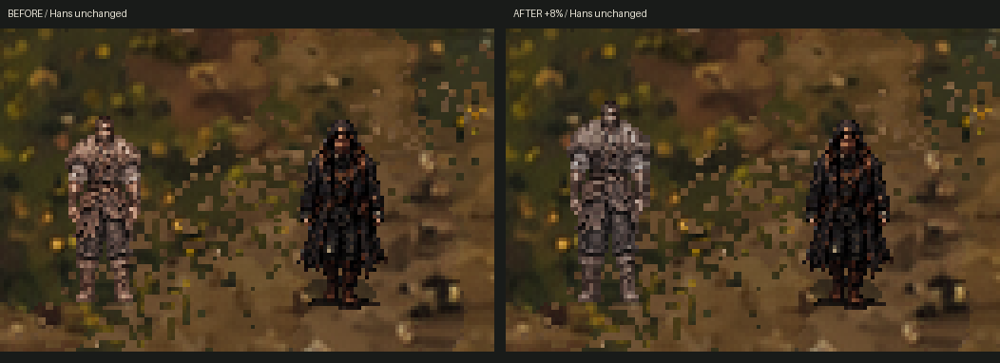
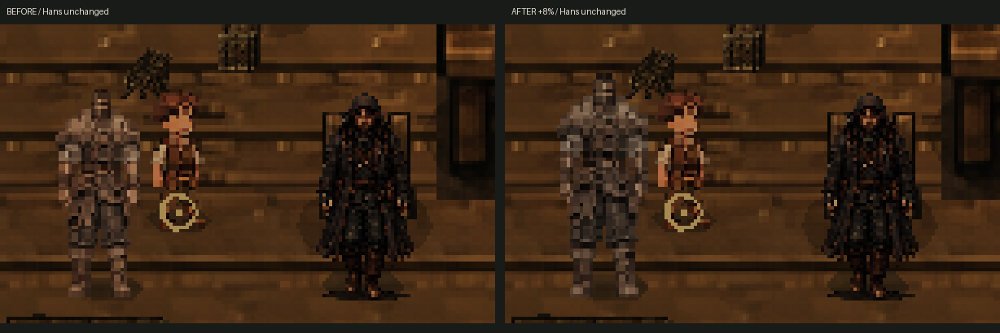
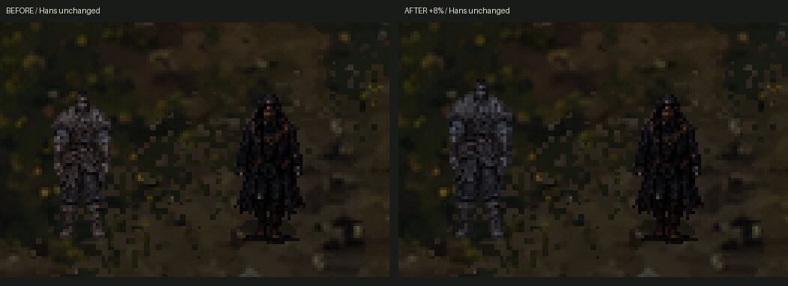
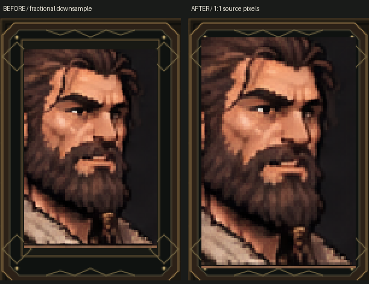

# Этап 5.4.3 — финальная визуальная корректировка дровосека

12 ноября 2026. Основа: `main`, `c90b6d3` — объединение PR #24. Ветка: `codex/stage543-woodcutter-polish`.

## Результат

Основной дровосек равномерно увеличен на **8%** относительно 5.4.2. Приглушены тёплые оттенки отдельным материалом, сохранившим обычное освещение сцены и прозрачность. Портрет отображается в исходном размере внутри прежней рамки, без перерисовки лица.

**Утверждённые анимации сохранены побайтово:** атлас, исходные листы, `frames.tres`, последовательности кадров, FPS, длительности, циклы и отражение влево не менялись. Та же настройка размера и цвета применяется ко всем позам, включая рубку, подъём, перенос и укладку. Расписания, маршруты, физические скорости и игровые механики сохранены.

## Размер, опора и коллизии

Изменён только `AnimatedSprite2D.scale` основного `woodcutter`: `(1,1)` → `(1.08,1.08)`. Его тень увеличена тем же коэффициентом. Масштаб `CharacterBody2D` остаётся `(1,1)`, камера, навигационный радиус и физическая капсула не менялись.

| Контрольный параметр | До | После |
|---|---:|---:|
| Силуэт `idle_down/0`, изолированный рендер при масштабе камеры 1 | 20 × 49 px | 22 × 53 px |
| Опора в тестовом viewport | нижняя граница y=96 | нижняя граница y=96 |
| Pivot исходного кадра | `(48,82)` | `(48,82)` |
| Смещение спрайта | `(-48,-82)` | `(-48,-82)` |
| Скорость тела при ×1 | 36 px/s | 36 px/s |
| Ганс | около 50 px роста, без изменений | без изменений |

Увеличение выполняется вокруг прежней точки ног, без раздельного растяжения по осям и без индивидуального масштабирования фаз шага. Дровосек получается примерно одного роста с Гансом, немного выше и массивнее по видимому силуэту. Коррекция коллизии не понадобилась: изменение ширины стопы меньше пикселя, исходный радиус сохраняет проходимость. Проверены существующая точка отдыха внутри дома, маршрут возвращения и полный игровой день.

Размер и смещение связки поленьев после укладки вычисляются из масштаба спрайта. Это сохраняет совпадение предмета в руках и на полу. Состояния доставки и её расписание не менялись. Небольшое отличие точек удара после увеличения не потребовало менять колоду/проходы; рабочая последовательность повторно проверена в графическом Godot.





## Палитра

`shaders/woodcutter_palette.gdshader` изменяет только RGB уже выбранного пикселя:

- Насыщенность — 0,8.
- Баланс RGB — `(0.94,0.97,1.0)`.
- Множитель экспозиции — 0,96.
- UV, альфа, рисунок, кадр и способ выборки не изменяются. Размытие, соседние выборки, деформация и `unshaded` не применяются.

Материал назначен только спрайту дровосека и его маленькой связке поленьев после укладки. Кожа, мех, ремни и ткань сохраняют исходные детали. Ганс, другие NPC, деревня, свет и туман не перекрашивались.

Изолированная GPU-проверка одной и той же стойки: **0 отличающихся альфа-пикселей**, средняя яркость после/до ≈ **0,9253**. Суммарная положительная разница красного и синего уменьшилась со 107,78 до 67,59. Это измерение цветового преобразования при одинаковом освещении, а не универсальная оценка всех состояний/сцен.

### День, вечер и ночь

Сделаны парные снимки при времени 12:00, 19:00 и 23:00 с неизменённым существующим освещением. Для этого диагностический стенд меняет читаемую фазу времени и сохраняет тех же неподвижных участников рядом; это не наблюдение их естественного расписания в указанные часы.

**Существенное ограничение основы:** наружный `Lighting/Evening.color` в текущей игре остаётся `(0.89,0.91,0.94)` во всех трёх фазах. Время влияет на атмосферные/звуковые профили, но смена часов сама по себе не создаёт другое общее освещение. Поэтому эти три снимка не выдаются за полноценные разные световые режимы. Суточное освещение на этом этапе не добавлялось и не менялось.

Дополнительно выполнен явно подписанный **тест читаемости при затемнении**, временный цвет `(0.38,0.45,0.56)` только на стенде. Персонаж остаётся различимым. Значение восстановлено, в игровые сцены не сохранено:



Внутри дома используются прежние CanvasModulate, печь и лампы; сравнение выполнено при штатном интерьерном зуме 1,3.

## Портрет

Исходные четыре PNG портрета и их кадрирование не менялись. Существующая нарезка 76×114 → 128×192 пропорциональна: подтверждённого растяжения лица по одной оси в ней нет. Однако UI помещал PNG 128×192 в область 110×176 с `Keep Aspect Centered`; фактическая картинка получалась около 110×165. При Nearest это дробное уменьшение даёт неравномерную выборку исходных столбцов/строк, заметную на маленьком лице.

Для портретов только этого дровосека теперь выбирается **128×192, масштаб 1:1**, с целочисленной центральной привязкой внутри существующей рамки 150×220. Рамка, окно, варианты ответов и текстовые области не увеличены. Лицо, борода, цвета и выражения сохранены. Для любого другого персонажа восстанавливается прежняя область портрета; это проверено после переключения с дровосека на старосту.



Проверены neutral/joy/displeased/anxious. Исходная стилизация лица и обрезка части причёски остаются прежними; полной анатомической перерисовки здесь нет. При изменении размеров окна или будущих портретов условие проверяет вместимость рамки и сохраняет исходную настройку, если вывод 1:1 не помещается.

## Что проверено

Среда: Godot **4.6.3 official**, Linux/X11, Compatibility/OpenGL, llvmpipe. Импорт и все перечисленные финальные журналы не содержат ошибок GDScript/шейдера/загрузки ресурсов. Ограничение VSync программного драйвера остаётся предупреждением среды.

| Проверка | Результат |
|---|---:|
| Новая графическая проверка размера, палитры, опоры, границ всех клипов и портретов | 161 прошла, 0 ошибок |
| Контракт исходников | 636 прежних файлов побайтово неизменны |
| Девять NPC, портреты и существующие разговоры | 316 / 0 |
| Переходы анимаций и перенос дровосека | 26 / 0 |
| Реальное вечернее возвращение, вход домой и укладка | 11 / 0 |
| Полный игровой день | 33 / 0 |
| Неизменность скоростей | 11 / 0 |
| Входы/выходы шести домов | 335 / 0 |
| Диалоговая система | 65 / 0 |
| Y-sort перед/за домом, сосной, забором и Гансом | 24 / 0; неверных пикселей 0 |
| Рабочая последовательность в графическом Godot | 30 / 0 |

В старом интеграционном тесте 5.4.2 обновлено только ожидаемое значение масштаба дровосека с 1 на 1,08. Проверки остальных восьми персонажей не ослаблены. SHA-256 утверждённых ресурсов:

```text
frames.tres a191de5fe6b952a98cbbb03cbec67469108f63dfb095a651f9e4e42ec9a9c493
atlas.png  d851cdf0dd7556ab37294389771cce9a66911be0916826278e54e57bad03de1e
```

В обычном графическом запуске главной сцены настоящими оконными WASD/E выполнены подход к дому, вход, разговор с дровосеком, закрытие разговора, движение внутри и выход к своей двери. Сохранены тот же Ганс, девять ID, камеры 1 → 1,3 → 1 и течение времени при ×1. Для разговора подход прекращался у физически доступной точки E, без требования войти в занятую NPC точку навигации. Итог: `deliverables/Stage543/logs/native-complete.json`; [снимок настоящего оконного разговора](deliverables/Stage543/native-woodcutter-dialogue-native.png). Временный read-only observer удалён из конфигурации после проверки.

## Материалы и воспроизведение

- [Все парные снимки и измерения](deliverables/Stage543/).
- [Видео после корректировки: ходьба, рубка, разговор, подъём, перенос и укладка](deliverables/Stage543/workshop-after.mp4). Это диагностическая постановка с тем же исходным актёром и настоящим `move_and_slide`, а не новая поведенческая система или лесная сцена.
- [Видео до — из объединённого этапа 5.4.2](deliverables/Stage542/workshop-diagnostic.mp4).
- [Журналы проверок](deliverables/Stage543/logs/).

Запись после — 960×540, около 20 FPS. Полностью декодирована ffmpeg. Статические парные снимки показывают размер и палитру; сохранность анимаций дополнительно подтверждается хешами и воспроизведением во времени. Непрерывная человеческая оценка плавности на целевом GPU здесь не подменяется набором скриншотов.

Из каталога `HutorReborn`:

```sh
godot --headless --path . --editor --import --quit
godot --path . --script res://tests/verify_woodcutter_543.gd -- /tmp/wood543
godot --path . --script res://tools/review_woodcutter_543_work.gd -- /tmp/work543
godot --headless --path . --script res://tests/verify_woodcutter_return.gd
python tests/verify_woodcutter_finish_sources.py
```

## Изменённые файлы и оставшаяся ручная проверка

Игровые изменения ограничены:

1. `scenes/npc/residents/woodcutter.tscn` — локальный масштаб спрайта/тени и назначение материала.
2. Новый `shaders/woodcutter_palette.gdshader` и `assets/npc/woodcutter542/game/palette_543.tres`.
3. `scripts/npc/rework/woodcutter_delivery.gd` — применение того же масштаба/материала к оставленной связке поленьев; логика доставки не менялась.
4. `scripts/dialogue/dialogue_window.gd` — вывод существующего портрета дровосека 1:1 и восстановление обычной области для других жителей.

Также добавлены новые проверки/диагностическая обёртка, уточнено одно ожидание масштаба в прежнем тесте, сохранены отчёт и доказательства. Исходные изображения, `SpriteFrames`, данные диалогов, расписания, остальные игровые сцены и механики не менялись.

Ручная проверка перед объединением: открыть F5, сравнить Ганса и дровосека на улице/дома; просмотреть четыре направления ходьбы при ×1 и рубку/перенос на стенде; убедиться, что новая масса не выглядит чрезмерной; проверить портреты на целевом разрешении. Масштаб 1,08 и прежний интерьерный зум 1,3 дробные: Nearest остаётся чётким, однако размер экранного пикселя может быть неравномерным. Само по себе это не изменение фаз походки. Тестирование Windows/целевого GPU и всех размеров окна не выполнено.

PR предназначен для ручного рассмотрения. Автоматическое объединение не выполнялось.
