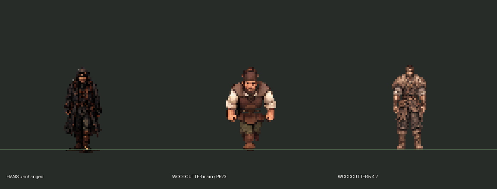

# Этап 5.4.2 — основной дровосек

Дата: 11 ноября 2026. Основа: `main` / `4884da5`, после объединения PR #23.

**Результат: новый игровой набор подключён к единственному существующему `woodcutter`; технические проверки пройдены. Художественная приёмка остаётся открытой.** Полного соответствия всем художественным критериям ниже не заявляем.

PR #23 относится к этапу 5.4.1 и уже объединён/закрыт. Продолжать его как открытый PR нельзя. Изменения 5.4.2 подготовлены отдельно в `codex/stage542-woodcutter-rework`. Повторно выполнять изменения 5.4.1 не потребовалось.

## 1. Сравнение с Гансом

Ганс и его четыре оригинальных листа в `assets/characters/hans/source/` изучены; они, нарезанные кадры и сцена героя не изменены. Сравнивались реальные масштабы, а не размеры исходных больших PNG.

| Параметр | Ганс | Дровосек 5.4.2 |
|---|---|---|
| Видимый рост в мире | около 49,5 px исходной альфы; около 50 px после Nearest | целевой 49,5 px; 49 px в выбранной стойке |
| Видимый силуэт выбранного кадра | примерно 22–23 × 50 px | 20 × 49 px (`idle_down/0`) |
| Ширина верхнего силуэта с одеждой | около 20 px | 20 px после локальной коррекции меха |
| Голова с волосами/капюшоном | ориентировочно 12 × 12 px | ориентировочно 8 × 11 px с собранными волосами |
| Ступни/привязка | pivot исходника `(480,1280)`; нижняя альфа включает край обуви/тени | pivot `(48,82)`; подошвы около y=82, без каталожной подложки |
| Размер кадра | `960 × 1344` | `96 × 96` |
| Масштаб игрового спрайта | ходьба `1/24`; боковой покой `1/21` | `Vector2.ONE` |
| Смещение относительно ног | существующее, не менялось | существующее `(-48,-82)` |
| Физическая скорость | 94 px/s, без изменений | 36 px/s при ×1, без изменений |
| Фильтрация | Nearest | Nearest, `AtlasTexture.filter_clip = true`, без mipmaps |

Измерения головы и конечностей приблизительны: борода, капюшон, мех и полы одежды скрывают анатомические ориентиры. Длины рук/ног проверялись по рисунку, а не объявлялись точными размерами суставов под одеждой. У новой стойки руки доходят примерно до верхней части бёдер, таз–подошва около 18–20 px. Погрешность таких ориентиров 2–3 px. Цифры головы не доказывают одинаковый размер черепа: у Ганса измеряется также капюшон.



Слева — неизменённый Ганс, в центре — прежний дровосек из `main` (представительный кадр ходьбы), справа — новый покой. Нижняя линия отмечает pivot, не границу подошвы. Это сравнение размеров, **не доказательство плавности движения**.

Новая фигура менее коренастая, сохраняет бороду, собранные волосы, мех, ремни и сапоги. Однако требование «немного шире Ганса в плечах» пока не достигнуто убедительно: измеренная ширина примерно совпадает. Расширение меха выполнено отдельной художественной правкой исходного листа, без непропорционального растягивания тела. Дальнейшую работу над массивностью следует принимать рядом с Гансом, одновременно во всех клипах.

## 2. Источники и созданные кадры

Внешность взята из приложенного референса. Последовательности на референсе не считались готовыми игровыми циклами: созданы новые авторские листы средствами генерации изображений, затем выполнены техническая очистка альфы, нарезка, равномерное уменьшение Nearest и выравнивание опоры. Программная деформация/вращение конечностей не применяется.

Ресурсы находятся в `HutorReborn/assets/npc/woodcutter542/`:

- `source/`: листы направлений, покоя, рубки, переноса, подъёма/укладки и социальных поз; исходный и уточнённый покой сохранены отдельно. `.gdignore` исключает большие авторские листы из игрового импорта.
- `game/atlas.png`: **67 разных игровых рисунков**, сетка `96 × 96`, атлас `768 × 864`.
- `game/frames.tres`: **36 совместимых имён анимаций**; алиасы используют те же рисунки, не добавляют фиктивные кадры.
- `game/placed_logs.png`: отдельная связка поленьев, технически извлечённая из кадра отпускания. Её размеры и пиксели совпадают с предметом в анимации.
- `manifest.json`: SHA-256 исходников, границы нарезки, равномерные масштабы, pivot, происхождение каждого игрового кадра и соответствие клипам.

| Набор уникальных рисунков | Количество |
|---|---:|
| Обычная ходьба: вправо / вниз / вверх | 6 + 6 + 6 |
| Покой: четыре направления | 2 × 4 |
| Рубка | 8 |
| Перенос: вправо / вниз / вверх | 6 + 6 + 6 |
| Покой с грузом: вправо / вниз / вверх | 3 |
| Использованные позы подъёма и укладки | 6 |
| Разговор и отдых | 3 + 3 |
| **Итого** | **67** |

Влево ходьба и перенос отражаются из правого направления ровно один раз. Для покоя влево есть собственные кадры. Неполные верхние границы двух исходных поз подъёма не попали в игру: выбраны целые позы и совместимые начальная/конечная стойки. Исправлены исходные ошибки противопоставления рук и ног; вариант переноса с лишней рукой отклонён.

В игровом атласе проверены: бинарная прозрачность, нулевой RGB прозрачных пикселей, отсутствие обрезания по границам кадров, 67 разных хешей рисунков. Красно-зелёная служебная кайма исходных листов очищена. Удалённая кайма и уменьшение не подменяют художественную оценку анатомии.

## 3. Анимации

| Клипы | Рисунков | Режим |
|---|---:|---|
| `idle_down/up/left/right` | по 2 | спокойный цикл, 2,5 FPS |
| `walk_down/up/left/right` | по 6 | цикл, 8 FPS; левая сторона отражена |
| `chop_wood`, `work_chop` | 8 | завершённый взмах, удар, восстановление; без автоматического бесконечного перезапуска |
| `carry_logs`, `work_carry`, `carry_right/left/down/up` | по 6 | цикл с грузом в руках, 8 FPS |
| `carry_idle_down/up/left/right` | по 1 | опора на обе ноги; груз сохраняется при разговоре/остановке |
| `pick_up_log`, `work_pick_up` | 4 | наклон, захват, выпрямление; 6 FPS, однократно |
| `put_down_log`, `work_put_down` | 4 | опускание, отпускание, пустая стойка; 6 FPS, однократно |
| `rest`, `work_rest` | 3 | жест отдыха и удержание конечной спокойной позы |
| `talk`, `talk_down` | 3 | фронтальная речь, 3 FPS |
| `talk_up/left/right` | по 2 | направленный нейтральный покой; специальных жестов пока нет |
| `turn_*`, `work_inspect` | 1 / 2 | совместимые направленные стойки |

Паузы в подготовке/восстановлении рубки задаются длительностью настоящих ключевых поз, без копирования картинок для количества. Смена направления сохраняет фазу ходьбы. Поднятый топор/поленья встроены в соответствующие рисунки; отдельная система программного движения рук не нужна.

## 4. Подключение и границы изменений

Из существующих файлов изменены только:

1. `scripts/npc/visuals/visual_library.gd` — ресурс 5.4.2 назначается только ID `woodcutter`.
2. `scripts/npc/npc_animator.gd` — только пилот завершает уже начатый рабочий жест перед визуальным приветствием, удерживает конечную позу однократного действия и выбирает направленный перенос. Логическое начало диалога/блокировка движения происходят сразу.
3. `scripts/life/activity_presenter.gd` — отдельный визуальный адаптер создаётся только дровосеку.
4. `scripts/npc/rework/work_bindings.gd` — существующие домашние `prepare_work` и `rest_after_work` используют новый отдых.
5. `data/visuals/animation_catalog.json` — обновлена только запись дровосека.

Новый `scripts/npc/rework/woodcutter_delivery.gd` читает существующий `return_from_work`, активный временной блок и местоположение. На прежнем вечернем пути домой показывает поленья. По достижении существующей точки `FatherRest` проигрывает укладку и оставляет соответствующую небольшую связку без коллизии. Положение NPC, его цель, физическая скорость, таймеры, расписание, переходы и диалоги адаптер не меняет. Завершённая доставка не повторяется при следующем отдыхе/смене сцены/на следующее утро. Если возвращение закончилось за кадром, оно не разыгрывается заново перед игроком.

**Сохранено побайтово:** все старые PNG и сцены, Ганс, ресурсы остальных восьми NPC, расписания, карта, интерьеры, тексты диалогов, камера и звук. Их каталог анимаций также сравнивается отдельно. Новые изображения добавлены, старые не удалялись. Портреты остались прежними; точное соответствие причёски новой модели портрету требует последующей художественной сверки.

### Что видно в обычной игре

Подключены обычные походки, направленный покой/разговор, отдых дома, перенос на вечернем возвращении и укладка после видимого прихода домой.

**Лесозаготовки по существующему расписанию остаются виртуальными за границей карты.** Новая лесная сцена не создавалась. Поэтому полный цикл «подход → рубка → подъём → перенос → укладка» показан отдельной диагностической постановкой на уже существующей карте. Это не новый автономный участок обычного маршрута и не доказательство того, что игрок может наблюдать рубку за границей хутора.

## 5. Проверки

Среда: Godot **4.6.3 official**, Linux/X11, Compatibility/OpenGL, программный GPU llvmpipe. Проверка редакторского импорта завершена; ошибок парсинга GDScript/отсутствующих ресурсов не найдено. Ограничение VSync у драйвера отражено в журнале.

| Проверка | Результат |
|---|---:|
| Девять жителей, существующие разговоры/портреты, сохранение идентичности | 316 / 0 ошибок |
| Удержание груза, четыре направления, однократные действия, парковка и следующий день | 26 / 0 |
| Полный игровой день, уход/возврат двух работников | 33 / 0 |
| Неизменность физических скоростей при ускорении времени | 11 / 0 |
| Шесть дверей, входы/выходы и обработка ошибок | 335 / 0 |
| Интерьеры предыдущего этапа | 706 / 0 |
| Детские маршруты | 7 / 0 |
| Диалоги | 65 / 0 |
| Атмосфера | 183 / 0 |
| Растровый Y-sort: основной дровосек, ребёнок и старик перед/за домом, сосной, забором и Гансом | 24 / 0; неверных пикселей 0 |
| Диагностический рабочий цикл в графическом Godot | 30 / 0 |
| Исходники и кадры | 67 разных рисунков; безопасные границы, альфа, защищённые файлы — проверка пройдена |

Интеграционная проверка реального вечернего возвращения — **11 / 0**: граница → вход в свой дом → движение с грузом внутри → укладка → те же ID/место жительства. Журнал: `deliverables/Stage542/logs/verify_woodcutter_return.log`.

В обычном запуске главной сцены, без SceneTree-стенда, вводились настоящие оконные WASD/E: дровосек сохраняет свой дом, вход/выход работает, камера переключается 1 → 1,3 → 1, информационная карточка не открывается, Ганс и все девять ID остаются теми же, время продолжает идти при ×1. Для наблюдения использован временный read-only observer; `override.cfg` после сеанса удалён, в проект не включён.

Диагностическая постановка использует того же существующего дровосека и настоящие `move_and_slide`, коллизию колоды и диалог по E. Граница колоды выверена под кадр удара; актёр остаётся на опоре. Поленья на земле скрываются при захвате и появляются после отпускания. Скорость тела не меняется. Положение камеры/участников и выбор клипа задаёт стенд — это отделено от обычного запуска.

## 6. Материалы

- [Видео реального воспроизведения в Godot — диагностический цикл](deliverables/Stage542/workshop-diagnostic.mp4), около 40 секунд, 960 × 540, захват около 16 FPS. Включает четыре направления ходьбы, рубку, настоящий разговор во время действия, подъём, четыре направления переноса, укладку и отдых. Первые секунды — запуск двигателя.
- [Крупный план той же записи, Nearest ×3](deliverables/Stage542/workshop-closeup-nearest.mp4). Это кадрирование записанного видео, масштаб игры не менялся.
- [Сравнение в игровой сцене](deliverables/Stage542/game-comparison.png).
- [Удар у колоды](deliverables/Stage542/game-impact.png).
- [Перенос](deliverables/Stage542/game-carrying.png).
- [Отдых](deliverables/Stage542/game-rest.png).
- [Существующий диалог](deliverables/Stage542/game-dialogue-after-work.png).
- [Обычный запуск: интерьер дома](deliverables/Stage542/native-woodcutter-inside.png).
- [Журналы тестов и обычного запуска](deliverables/Stage542/logs/).

MP4 полностью декодирован ffmpeg без ошибок. Просмотрены последовательные снимки/временная развёртка, контролировалось изменение кадров и физическое перемещение в запущенном Godot. Здесь нет непрерывного человеческого просмотра видео в реальном времени: безупречная плавность/отсутствие любого скольжения этим не гарантируются. Видеозахват 16 FPS также не доказывает плавность на целевой платформе.

## 7. Оставшиеся недостатки

1. **Художественная приёмка открыта.** Плечи нового дровосека пока примерно равны плечам Ганса, а не явно шире. Оттенок меха светлее окружения. Нужна проверка цельности силуэта и массы одновременно в ходьбе, покое и рабочих позах, без простого растягивания.
2. В некоторых переходах между независимо подготовленными листами могут читаться небольшие изменения формы одежды/лица. Отсутствие таких скачков во всех состояниях не подтверждено; 67 разных рисунков и успешные тесты не означают идеальную анатомию/походку.
3. Специальных боковых/задних разговорных жестов нет — используются правильные нейтральные направления. Плавных нарисованных поворотов между ракурсами нет.
4. Работа в виртуальном лесу не превращена в видимый автономный трудовой цикл. Подъём/рубка проверены диагностически; доступность их игроку требует отдельного решения о месте работы при сохранении расписания.
5. Декоративная доставка не является инвентарём, экономикой или системой заготовок. Состояние хранится в существующей сессии NPC; новое сохранение игры на диск не добавлялось.
6. Требуется ручная проверка в Godot/на целевой машине: стопа на земле в непрерывном цикле, естественность рук, стык последнего и первого шага, разговор во время разных фаз, интерьерный зум 1,3, ночь и разные разрешения. Nearest при дробном зуме 1,3 сохраняет жёсткую выборку, но экранные пиксели могут иметь неравномерный размер; камера не менялась.

## 8. Как повторить

Открыть `HutorReborn/project.godot` в Godot 4.6.x и запустить F5. Утром войти в дом дровосека, проверить покой/движение, разговор по E и выход. Проверить вечерний возврат после 18:00: работник идёт от прежнего северного перехода с поленьями, доходит до своего дома, при наблюдаемом приходе укладывает их у `FatherRest` и отдыхает. Ускорение времени F7 — прежний отладочный инструмент; проверить и при ×1. Перейти в другую сцену во время пути/укладки, вернуться и убедиться, что груз/доставка не запускаются повторно. Следующим утром дровосек идёт на работу без вчерашнего груза.

Для покадровой художественной проверки открыть новый `frames.tres`; не менять масштаб Ганса для сравнения. Сначала оценить движение в настоящем размере, затем увеличить окно/снимок целочисленно. Проверить все четыре направления обычной ходьбы/переноса, отдых и удар; неподвижный скриншот не заменяет просмотр цикла.

Воспроизводимые диагностические команды из каталога `HutorReborn`:

```sh
godot --headless --path . --editor --import --quit
godot --headless --path . --script res://tests/verify_woodcutter_542.gd
godot --headless --path . --script res://tests/verify_woodcutter_delivery.gd
godot --headless --path . --script res://tests/verify_woodcutter_return.gd
python tests/verify_woodcutter_sources.py
godot --path . --script res://tools/review_woodcutter_542.gd -- /tmp/wood542
```

Для повторной технической сборки атласа из сохранённых авторских листов: `python tools/prepare_woodcutter_542.py` (Pillow, NumPy, SciPy). Это изменяет только производные ресурсы нового дровосека; для обычного открытия проекта Python не нужен. Старые Stage54/541 тесты с жёстким ожиданием восьми кадров у всех девяти жителей не являются контрактом нового шестикадрового пилота; их заменяет новый тест с неизменёнными требованиями к остальным восьми.

Новые игровые локации, новые NPC, изменения диалогов/расписаний/переходов и автоматическое объединение PR отсутствуют.
