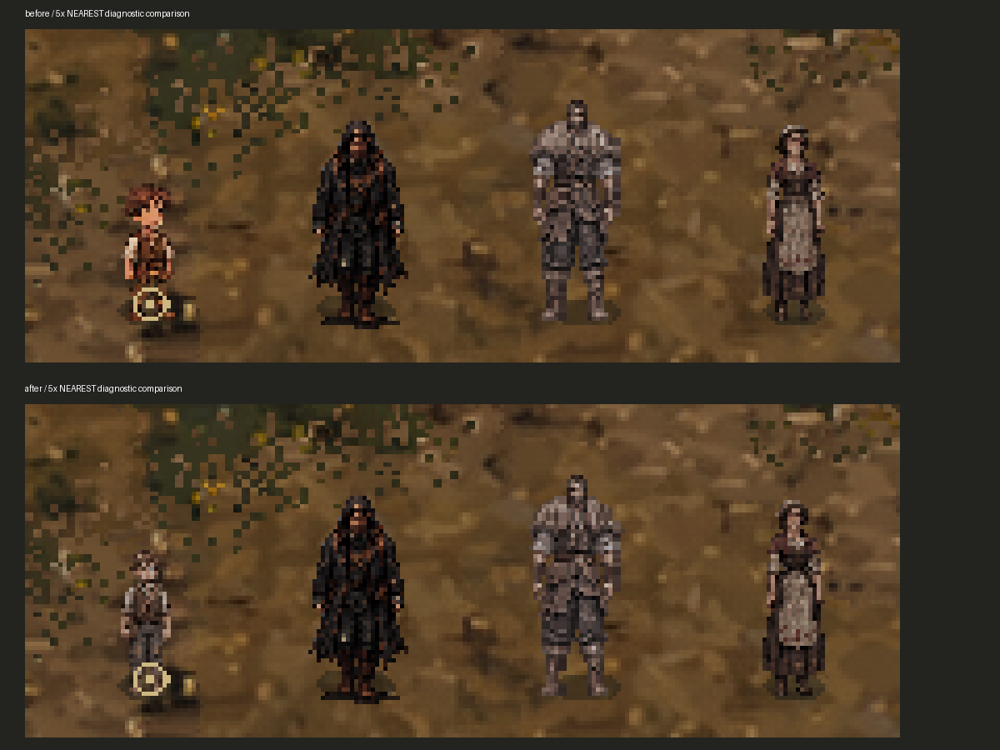
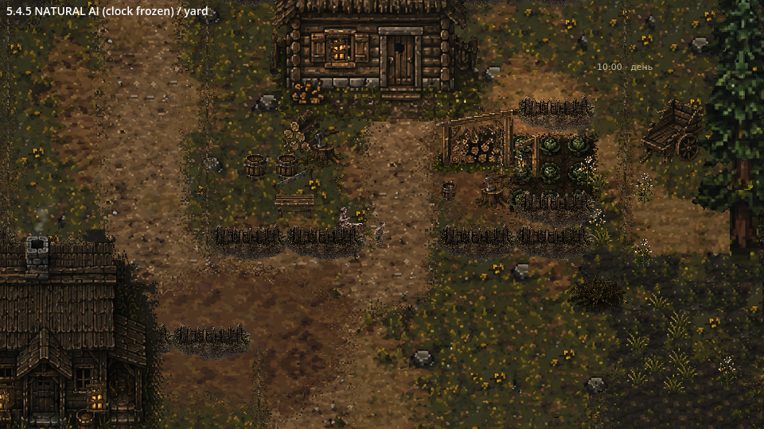
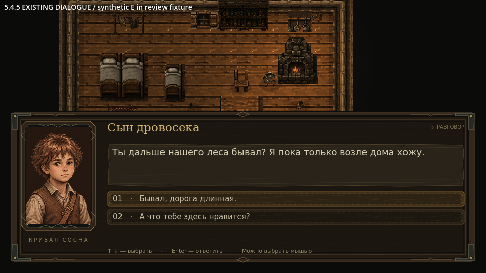

# Этап 5.4.5 — сын дровосека

Основа: `main`, коммит `08c9d04` после объединения PR #26 (переработка жены). Изменения PR #24–26 сохранены. Ветка: `codex/stage545-woodcutter-son`. Проверка: Godot **4.6.3 stable**, Linux, Compatibility/OpenGL, llvmpipe, 12 ноября 2026 года.

Обновлены только модель сына, его портреты, собственные короткие игры и необходимые точки подключения. Существующие расписания JSON, часы суток, маршруты и координаты занятий, диалоги, карты, интерьеры, звук, Ганс и остальные восемь моделей сохранены.

## Графика и масштаб

Основной художественный референс — приложенный пользователем лист мальчика: растрёпанные каштановые волосы, светлая рабочая рубашка, коричневый жилет, заплаты, сапоги и небольшая сумка. Этот лист не выдаётся за готовые игровые кадры. По нему подготовлены **новые нарисованные генератором изображений позы** и четыре выражения портрета. Это новые производные изображения, а не автоматически оживлённый один кадр и не уменьшенная модель отца.

Исходники сохранены без изменений в `HutorReborn/assets/npc/woodcutter_son545/source/`: `idle`, `right`, `down`, `up`, `run_right`, `run_down`, `run_up`, `play`, `jump`, `portrait`. Папка исключена из игрового импорта через `.gdignore`, но включена в Git. Старые изображения мальчика не удалены и не заменены на диске.

`tools/prepare_woodcutter_son_545.py` воспроизводит техническую обработку: очистку прозрачного фона и яркой краевой примеси, выделение фигур, равномерное масштабирование Nearest и сборку атласа. Исходные конечности не дорисовываются программно. На лист действует один коэффициент масштаба; присевшие позы не вытягиваются до роста стоящего персонажа. Сомнительные первые варианты фона Idle и неверно ориентированного бега не использованы.

- **58 уникальных нативных поз**, атлас `game/atlas.png`, ячейки 96 × 96, опора `(48, 82)`, стандартное смещение спрайта `(-48, -82)`.
- Ориентир стоящего мальчика — **35,5 пикселя** против примерно 50 у Ганса; родители остались в своих утверждённых масштабах. Узкое детское тело, без взрослой мускулатуры.
- Масштаб узла `Vector2.ONE`, Nearest, без размытия и непропорционального растягивания. Коллизия ног сохранена: радиус 4, центр `(0, -3)`.
- Собственный материал использует уже существующий шейдер палитры с насыщенностью 0,8 и экспозицией 0,96. Материалы и графика родителей не изменены.
- Портреты 128 × 192: neutral, joy, displeased, anxious. Кадрирование сохраняет пропорции, лицо не растягивается. В диалоговом JSON сына изменены только пути картинок; текст и варианты ответов побайтно сохранены.



## Какие анимации действительно есть

| Анимации | Рисунки / воспроизведение | Использование |
|---|---|---|
| `idle_down/up/right/left` | 2 позы на направление | Покой; слева отражение правых поз |
| `walk_down/up/right/left` | 6 выбранных фаз, 7 FPS при обычной скорости | Контакт, проходящая нога, перенос веса для обеих ног |
| `run_down/up/right/left` | 6 отдельных беговых фаз, 10 FPS | Наклон, согнутые руки, более широкий шаг и фаза полёта |
| `work_ball` | 4, однократно | Подготовка ноги, удар и восстановление |
| `work_kneel_down` | 2, однократно | Наклон и приседание |
| `work_kneel`, `work_inspect` | 2 | Осмотр маленького предмета у земли |
| `work_stand_up` | 3, однократно | Возврат из приседания в стойку |
| `work_jump` | 5, однократно | Подготовка, толчок, полёт, приземление, восстановление |
| `work_joy` | 3, однократно | Небольшой жест после игры |
| `work_rest` | 1 | Спокойная пауза, без повторения жеста по кругу |
| Разговор | 3 боковые позы; спереди/сзади направленный Idle | Поворот к Гансу, без продолжения бега |

**31 имя в SpriteFrames не означает 31 независимую анимацию:** присутствуют совместимые псевдонимы. Левые ходьба и бег отражают правые ровно один раз, включая сумку. Не добавлялись одинаковые кадры для достижения восьми: из каждого восьмипозного листа движения выбрано шесть фаз; почти одинаковые соседние рисунки отброшены. Хеши подтверждают отсутствие точных дубликатов, но сами по себе не доказывают естественность анатомии.

[Нативные позы](deliverables/Stage545/Native-poses.png) · [Ходьба во времени](deliverables/Stage545/Walk-time-sequence.png) · [Бег во времени](deliverables/Stage545/Run-time-sequence.png) · [Увеличенный фрагмент движения, MP4](deliverables/Stage545/Gaits-nearest.mp4)

## Что реально происходит в игре

Сын использует собственный подкласс `son_actor_545.gd`; остальные жители продолжают использовать прежние контроллеры. Путь, препятствия, двери и разговоры обслуживают существующие системы.

**Ходьба и бег.** Раньше коэффициент 1,25 повышал скорость всех перемещений сына, хотя беговая анимация включалась только на `run_*`. Теперь выбор скорости и рисунков согласован: ходьба **34,1**, бег **77,5** игровых пикселя/с при ×1. Во дворе он бежит к игре, на участках `run_*`, обратно во двор и к матери; к спокойному осмотру и в помещении идёт пешком. Есть разгон и торможение перед конечной точкой. Частота кадров зависит от реальной скорости. Общий ресурс определения со скоростью 62 не изменяется.

**Мяч.** В существующих паузах `play_stick` / `return_yard` мальчик может пнуть мяч, дождаться его короткого переката, добежать по настоящему пути AStar, присесть, поднять и вернуться к месту игры. Использована уже имеющаяся текстура `stage54/game/props/toy_ball.png`; новый постоянный объект карты не требуется. Перед ударом проверяется свободный коридор полным телом. Во время погони действуют коллизии, динамические препятствия и безопасная область. При блокировке занятие безопасно прекращается, персонаж не телепортируется.

**Другие игры.** В коротких последовательностях чередуются мяч, осмотр камешка/маленького предмета и прыжок; паузы и направление удара меняются. В `kneel_toy`, `inspect_well`, `home_play` приседание связано с реальным занятием, а не подменено Idle. Перед уходом из присевшего занятия проигрывается подъём. В доме нет погони за мячом или прыжков между мебелью.

**Расписание.** Все исходные временные границы и места занятий сохранены: утренний выход, дневные дворовые занятия, визиты к матери, существующая прогулка к дереву/колодцу, домашний вечер с 18:00 и ночное пребывание дома. Нового распорядка суток нет. Виртуальная оценка пути использует ту же выбранную скорость сына; для остальных жителей расчёт остался прежним.

**Разговор.** Сразу обнуляется скорость, игра и положение мяча приостанавливаются. Мальчик поворачивается к Гансу; после разговора восстанавливает ориентацию занятия, фазу игры и курсор рабочей анимации. Занятие не продолжается на фоне диалога.

**Смена сцен.** Сохраняются один объект сына, его ID и существующий механизм резидентности. Временный мяч удаляется при парковке актёра; оставленная без игрока микропоследовательность не симулируется отдельной системой. При возвращении продолжается актуальное занятие расписания, но его короткая игра начинается заново. Это не сохранение каждого кадра перекатывающегося мяча.




## Проверки и доказательства

Проверялся не только импорт. Есть два разных вида запуска:

1. **Диагностический графический просмотр** `tools/review_son_545.gd`: существующие миры и оригинальные тела, часы временно зафиксированы для наблюдения. Сначала настоящие занятия AI во дворе; затем специально расставленное сравнение семьи и физические проходы в четырёх направлениях для обоих типов движения; далее существующий интерьер и разговор через E. Расстановка сравнения и тестовое перемещение Ганса происходят только внутри инструмента. Они не являются записью свободной игры. **26 проверок пройдено.** [Запись 108 секунд](deliverables/Stage545/World-review.mp4), [журнал](deliverables/Stage545/graphical-review.log).
2. **Обычный запуск главной сцены**, настоящий X11-клавиатурный ввод через XTest: WASD к двери, E для входа, подход к сыну, E для разговора, Escape, выход, наблюдение во дворе, вечерний возврат сына домой. Ганс не телепортируется; наблюдатель только читает состояние и рассчитывает маршрут для тестовой клавиатуры. Для ожидания утра/вечера использована существующая отладочная F7, затем обычная скорость. Сохранены исходный Ганс и все девять ID жителей. За 24 секунды наблюдения двора видны ходьба, бег, приседание, осмотр, подъём и паузы; удар мячом подтверждён отдельно графическим просмотром и тестом фаз. [Запись](deliverables/Stage545/Native-playtest.mp4), [действия и состояния](deliverables/Stage545/native-native-actions.jsonl), [итог](deliverables/Stage545/native-result.json).

| Проверка | Результат |
|---|---:|
| Импорт редактором Godot 4.6.3 | Без ошибок импорта/разбора |
| `verify_residents_545.gd` — все девять оригинальных жителей, направления, эмоции, реальные диалоги | 316 / 316 |
| `verify_son_games_545.gd` — реальные фазы игры, пауза погони при разговоре, обе скорости, коллизии, смена сцен, вечер | 31 / 31 |
| `verify_child_play.gd` — дворовой цикл, мать, безопасная область и возврат домой | 7 / 7 |
| `verify_daily_cycle.gd` | 33 / 33 |
| `verify_door_transitions.gd` | 335 / 335 |
| `verify_worker_speed.gd` — неизменность ресурсов/скоростей других работников | 11 / 11 |
| `verify_dialogue.gd` | 65 / 65 |
| `verify_son_depth_545.gd` — реальные пиксели перед/за домом, сосной, забором и Гансом | 8 / 8, ошибочных наложений 0 |
| `verify_son_sources_545.py` | 645 защищённых старых файлов неизменны; остальные восемь записей анимаций/портретов сохранены; 58 уникальных поз; альфа 0/255, прозрачный RGB обнулён; границы кадров целые |

Старый тест игры считал только номер кадра: разные новые действия с кадром `0` ошибочно сливались в одну позу. Он обновлён для учёта пары **имя клипа / номер кадра**. Ранняя проверка также обнаружила, что при новой спокойной ходьбе сын опаздывал к движущейся матери; только его существующий наружный визит переведён на бег. Финальные проверки цикла, визита и диалога проходят. Старые промежуточные результаты не выдаются за успешные финальные.

В графических журналах остаётся предупреждение llvmpipe о недоступном V-Sync. Ошибок GDScript, отсутствующих ресурсов, сбоев сцен или игровых исключений в проверенных запусках не обнаружено. MP4 проверены полным декодированием. Логи и [пиксельный аудит глубины](deliverables/Stage545/depth.json) приложены.

## Ограничения художественной проверки

- Проверены кадры и последовательности захваченного движения во времени; это не заключение профессионального аниматора и не обещание полного отсутствия скольжения на любом диагональном пути. Финально оценить обе ноги, мах рук, сумку и согласованность лица на поворотах нужно по MP4 и в редакторе при ×1.
- На игровом росте около 36 пикселей камешек и пальцы занимают единицы пикселей. Это нарисованное занятие без отдельной системы собираемых предметов. Мяч — небольшой визуальный предмет с ограниченным перекатом, а не новый физический/инвентарный объект для Ганса.
- Тихий разговор спереди/сзади использует направленный Idle; отдельных фронтальных/тыльных артикуляционных кадров нет. Слева отражаются правая походка и сумка. Если нужна анатомическая асимметрия сумки и полностью независимая левая сторона, потребуется дополнительный нарисованный набор.
- При переключении направления сохраняется фаза шага, но смена проекции на 90° остаётся сменой четырёхнаправленного спрайта. Новых промежуточных восьми направлений нет.
- Обычный запуск проверен одним сквозным сеансом, а не многочасовой игрой во всех сочетаниях погоды и тесных встреч NPC. Возврат вечером в native-сеансе подтверждён состоянием и ID; внутри дома в этот момент камера не находилась. Отдельный тест проверяет существующий переход сына через дверь.
- Ручная приёмка: сравнить ребёнка с родителями на целевом мониторе, просмотреть полный цикл каждого направления, удар/захват мяча, прыжок и возобновление занятия после разговора. Именно поэтому метаданные не объявляют художественную переработку окончательно одобренной.

## Затронутые файлы и воспроизведение

Игровые изменения: новая папка `assets/npc/woodcutter_son545/`; сцена `scenes/npc/residents/woodcutter_son.tscn`; три новых son-скрипта в `scripts/npc/rework/`; подключения в `scripts/npc/visuals/visual_library.gd`, `scripts/life/activity_presenter.gd`, `scripts/life/village_life.gd`; защита окончания однократного клипа сына в `scripts/npc/npc_animator.gd`; только портретные ссылки сына в `dialogues/residents/woodcutter_son.json`, `data/visuals/residents.json`, `data/visuals/animation_catalog.json`; нативное размещение только нового портрета сына в `scripts/dialogue/dialogue_window.gd`.

Проверки/инструменты: обновлён `tests/verify_child_play.gd`; добавлены `verify_residents_545.gd`, `verify_son_games_545.gd`, `verify_son_depth_545.gd`, `verify_son_sources_545.py`; `tools/prepare_woodcutter_son_545.py`, `tools/review_son_545.gd`, `tools/native_son_545.py`. Остальное — этот отчёт, UID/import-описания новых ресурсов и `deliverables/Stage545/`.

Из каталога `HutorReborn`:

```sh
godot --headless --editor --path . --import
godot --headless --fixed-fps 60 --path . --script res://tests/verify_son_games_545.gd
godot --path . --script res://tools/review_son_545.gd -- /tmp/son545-review
python tests/verify_son_sources_545.py
```

Обычный клавиатурный тест требует X11. В первом терминале: `python tools/native_window_playtest.py launch --output /tmp/son545-native`. Во втором: `python tools/native_son_545.py --output /tmp/son545-native`. Нужен новый пустой каталог для каждого запуска. Временный наблюдатель удаляет `override.cfg` после завершения; в PR его нет.

**Автоматическое объединение PR не выполняется.**
