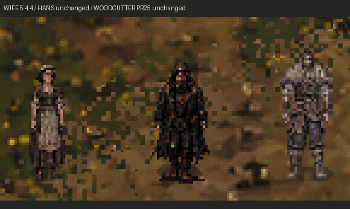

# Этап 5.4.4 — жена дровосека

12 ноября 2026. Основа: `main` / `0a48dab` после объединения PR #25. Ветка: `codex/stage544-woodcutter-wife`.

**Новая модель подключена только к существующему `woodcutter_wife`.** В обычной игре используются новые походки, покой, разговор, подметание, готовка, стирка, огородная работа и спокойный отдых. Отдельно подготовлены и продемонстрированы подъём/перенос/укладка корзины и протирание стола; новые задания расписания для них не добавлены. Эти две постановки не выдаются за автономные занятия в обычной игре.

## Графика и масштаб

Использован прежний утверждённый `assets/npc/stage54/references/woodcutter_wife.png`. Мужской лист в последнем сообщении служил ориентиром качества, а не источником женского тела. Модель не получена уменьшением/деформацией дровосека. Новые листы созданы генератором изображений по референсу жены; Ганс использован как стилистический и размерный ориентир.

Сохранены коричневые волосы, собранные под светлым платком, приглушённая ржавая шаль, тёмное платье/лиф, светлый передник с вышивкой, подвёрнутые рукава и сапоги. Голова и конечности имеют более взрослые пропорции, чем у прежнего маленького референсного тела. Все ракурсы используют одну одежду и узнаваемую внешность.

| Параметр | Ганс, без изменений | Дровосек PR #25, без изменений | Новая жена |
|---|---:|---:|---:|
| Видимый рост, примерно | 50 px | 53 px | 47–48 px |
| Масштаб игрового спрайта | прежний `1/24` для ходьбы | прежний `1.08` | `1.0` |
| Размер нового кадра | прежний | прежний 96×96 | 96×96 |
| Pivot / offset жены | — | — | `(48,82)` / `(-48,-82)` |
| Физическая скорость при ×1 | 94 px/s | 36 px/s | **32 px/s, сохранена** |

Показатели роста относятся к видимой альфе и зависят от позы/округления Nearest, а не являются точной анатомической мерой. Новая жена немного ниже обоих мужчин. В рабочем наклоне и на коленях размер тела не нормализуется заново: сохраняется масштаб стоящей фигуры.



Для сравнения на стенде временно расположены **те же существующие актёры**, без дубликатов; это не сохранённое изменение их маршрутов. Ресурсы Ганса, дровосека, сына и остальных жителей сохранены.

## Ресурсы и нарезка

Новый комплект: `HutorReborn/assets/npc/woodcutter_wife544/`.

- `source/`: 13 отобранных авторских листов и `.gdignore`; большие листы не импортируются в игру.
- `game/atlas.png`, `frames.tres`: **66 уникальных игровых рисунков**, **33 совместимых имени клипа**, сетка 96×96.
- `game/basket_ground.png`: корзина, отделённая из настоящего кадра отпускания. В последней пустой стойке её отдельный силуэт убран, чтобы предмет на полу не рисовался дважды.
- `game/palette.tres`: собственный материал жены, использующий прежний RGB-шейдер без изменения его файла/материала мужа. Насыщенность 0,8, баланс `(0.94,0.97,1)`, экспозиция 0,96. Обычное освещение сохраняется.
- `manifest.json`: источники, SHA-256, точные границы нарезки, равномерные масштабы, смещения, pivot и соответствие рисунков клипам.

Рабочие листы проверены отдельно от игры. Отклонены диагональные варианты вместо фронта/спины и перенос с лишней рукой. Вниз/вверх добавлены отдельные проходные фазы между противоположными касаниями: шесть фаз не набраны повторением одной позы. Две обрезанные верхние позы исходного листа подъёма не используются; начальная стойка берётся из целого направленного покоя, удержание — из целой нижней строки.

Техническая подготовка не деформирует конечности: только очистка служебной каймы/альфы, раздельная нарезка, равномерное уменьшение Nearest и регистрация по обуви/коленям. Для наклонов и подметания проверены отдельные точки опоры, чтобы корзина или щетина метлы не смещали персонажа. Прозрачные RGB обнулены; альфа игрового атласа бинарная. Исходные PNG проекта не удалялись/перезаписывались.

## Анимации

| Группа | Рисунков в клипе | Использование |
|---|---:|---|
| `idle_down/up/right/left` | по 2 | обычный покой; левый ракурс отражает правый |
| `walk_down/up/right/left` | по 6 | настоящие направленные походки, 8 FPS; влево отражение вправо один раз |
| `talk`, `talk_down` | 3 | спокойные фронтальные жесты |
| `talk_up/right/left` | по 2 | правильный направленный нейтральный покой; отдельных разговорных жестов нет |
| `turn_*` | по 1 | существующие краткие взгляды/повороты |
| `work_sweep` | 6 | метла в двух руках, щетина движется у пола |
| `work_rake` | 6 | отдельная деревянная головка граблей, прежняя огородная работа |
| `work_cook` | 3 | ложка у существующего котелка; без встроенной мебели |
| `work_sort` | 2 | работа с тканью/бельём в руках в прежнем `serve` |
| `work_laundry` | 3 | движения рук с бельём у прежнего отдельного таза |
| `kneel_down`, `work_kneel_down` | 3 | нарисованный переход к стирке |
| `stand_up`, `work_stand_up` | 3 | подъём перед разговором после стирки |
| `rest`, `work_rest` | 3 | однократный спокойный жест и удержание конечной стойки |
| `carry_basket`, `work_carry` | 6 | перенос в двух руках вправо/отражённый влево; диагностическая демонстрация |
| `pick_up_basket`, `put_down_basket` | по 4 | наклон, захват, выпрямление, отпускание и пустая стойка |
| `work_wipe` | 3 | протирание настоящего стола на диагностическом стенде |

Имена-алиасы используют те же реальные рисунки. Число имён клипов не считается числом новых картинок. Уникальные группы: обычная ходьба 18, покой 6, метла 6, грабли 6, кухонные/тряпка 6, перенос 6, разговор/отдых 6, подъём/укладка 6, стирка/вставание 6 — всего 66.

## Что реально подключено

Новые изображения назначены существующему ID через `visual_library.gd`. Все остальные ID по-прежнему получают прежние ресурсы. Общие компоненты изменены только в ветках/метаданных жены:

- `sweep_yard`, `clean` → новая метла.
- `cook` → новая готовка у `KitchenPot`.
- `household` → новая стирка у прежнего отдельного таза.
- `garden_work` → новые грабли вместо нейтрального ожидания.
- `serve` → небольшие движения с тканью в руках.
- `rest_night` → новый спокойный отдых.

Один разрешённый локальный подход уточнён для контакта с посудой: вместо исходной точки готовки `(584,312)` визуальная привязка выбирает `KitchenPot.position + (-26,2)` — в текущем доме `(552,280)`. Это поправка на 32 px по каждой оси; котелок, мебель, дом и двор не перемещались. JSON расписания, времена и остальные маршрутные точки сохранены. Точка проверена навигацией/физикой и снимком работы ложкой.

`wife_presentation_544.gd` добавляет только нарисованные вход на колени и подъём перед разговором. Он не меняет координаты тела, скорость, расписание, таймеры или логическое состояние NPC. При разговоре тело логически останавливается сразу; завершив подъём, изображение переходит к направленному разговору. После разговора используется прежний владелец занятия и сохранённый рабочий курсор. Движение имеет прежний приоритет. У фиксированных рабочих поверхностей сохраняется правый авторский ракурс: разговор с Гансом слева не отражает ложку от котелка или руки от таза. Логическое направление NPC при этом не переписывается; после подъёма разговор действительно поворачивается к Гансу. Однократные действия нового ресурса удерживают финальную позу; прежнее поведение остальных NPC сохраняется.

**Корзина и протирание стола не получили новых автономных маршрутов.** Полный цикл корзины показан настоящим `move_and_slide` на свободном участке существующей карты. Протирание показано у существующего `DiningTable` с проверенным подходом; временная рабочая отрисовка поверх края стола применяется только на стенде. Эти постановки не записаны в игровые сцены.

## Портрет

Сохранены все четыре ранее утверждённых PNG жены: платок, причёска, лицо и выражения не перерисовывались. Устранено дробное уменьшение в UI тем же способом, который уже принят для мужа: 128×192 в масштабе 1:1 внутри прежней рамки, с целочисленным центрированием. Это действует только для портретов жены дополнительно к прежней ветке дровосека. Остальные портреты возвращаются к прежней области; тексты, ответы, граф диалога и размеры окна не менялись.

## Проверка

Godot **4.6.3 official**, Linux/X11, Compatibility/OpenGL, llvmpipe. Финальный импорт и перечисленные журналы без ошибок GDScript, загрузки ресурсов или шейдера. Предупреждение о недоступности VSync относится к драйверу среды.

| Проверка | Результат |
|---|---:|
| Девять существующих жителей, разговоры, портреты, переходы и идентичность | 316 / 0 ошибок |
| Рабочая ориентация и разговор с подходом слева | 16 / 0 |
| Графический прогон жены: настоящие привязки, четыре направления, корзина, работа, разговоры, подъём | 65 / 0 |
| Y-sort жены перед/за домом, сосной, забором и Гансом | 8 / 0, неверных пикселей 0 |
| Полный игровой день | 33 / 0 |
| Шесть входов/выходов | 335 / 0 |
| Возвращение дровосека и укладка груза из предыдущего этапа | 11 / 0 |
| Скорости работников | 11 / 0 |
| Диалоговая система | 65 / 0 |
| Контракт ресурсов | 629 прежних файлов побайтово сохранены; записи анимаций остальных восьми жителей неизменны |
| Новый атлас | 66 разных рисунков; безопасные границы, прозрачность, контрольные суммы и шесть разных рисунков в каждом направлении проверены |

После последнего уточнения проходных рисунков вниз/вверх повторены сборка/импорт, контракт ресурсов, 316 интеграционных проверок и полный графический прогон 65 проверок с новой записью. Рабочие/диалоговые и физические данные при изменении рисунков не менялись. Успешный обычный оконный сеанс ниже выполнен перед этим последним графическим уточнением; более поздний автоматический повтор не завершился, поскольку контроллер не выбрал движущуюся жену за отведённые попытки. Он не засчитан как успешная проверка; ошибок Godot в нём не было.

В обычном запуске главной сцены настоящими оконными WASD/E: вход в дом семьи, подход к жене, разговор и закрытие, выход к своей двери, затем прежним F7 ускорено ожидание её выхода во двор. После возврата времени на ×1 наблюдались **32 px/s**, прежнее занятие `sweep_yard` и настоящий `work_sweep`. Сохранены все девять ID, Ганс и камера. Временный read-only observer убран из конфигурации после теста.

## Снимки и видео

- [Полная запись Godot](deliverables/Stage544/wife-work-review.mp4), около 52 секунд, 960×540, захват около 20 FPS. Включает работу во дворе, начало/конец разговоров, сравнение троих, четыре направления, метлу/грабли/отдых, физический перенос, работу дома и диагностическое протирание.
- [Крупный план той же записи, Nearest ×3](deliverables/Stage544/wife-work-closeup.mp4). Это кадрирование; масштаб игры не изменён. Диалог целиком виден в полной записи.
- [Сравнение троих в исходном игровом масштабе](deliverables/Stage544/review-comparison-wife-Hans-woodcutter.png).
- [Готовка у существующего котелка](deliverables/Stage544/review-natural-cook.png).
- [Стирка в доме](deliverables/Stage544/review-natural-household.png).
- [Протирание — отдельная диагностическая постановка](deliverables/Stage544/review-diagnostic-table-wipe.png).
- [Перенос корзины](deliverables/Stage544/review-carry-basket.png).
- [Обычный оконный запуск: разговор](deliverables/Stage544/native-wife-dialogue-home.png).
- [Обычный оконный запуск: работа во дворе при ×1](deliverables/Stage544/native-wife-yard.png).
- [Журналы и результаты](deliverables/Stage544/logs/).

Натуральные привязки проверяются на прежних точках и предметах; для снимков стенд выбирает время, останавливает участников и устанавливает камеру. Сравнение/проход по коридору/корзина/стол — диагностическая хореография. Это отделено от обычного оконного сеанса, где никто не телепортировался тестом. Видео декодировано без ошибок; проверены временные кадры и физическое воспроизведение, но непрерывная человеческая художественная приёмка на целевой машине этим не заменяется.

## Оставшиеся ограничения

1. Ручной просмотр при ×1 нужен для окончательной оценки скольжения, опорных фаз, стыка цикла и небольших различий одежды/лица между независимо подготовленными листами. Контроль альфы, границ, уникальности и успешные тесты не доказывают безупречную анатомию/плавность всех кадров.
2. Влево применяется отражение: асимметричные детали одежды тоже отражаются. Боковые/задний разговоры используют нейтральные направленные позы, а не отдельную полноценную жестикуляцию.
3. Перенос с корзиной подготовлен только для горизонтальных направлений. Полных ходовых ракурсов с грузом вверх/вниз нет. Автономная доставка корзин не добавлялась; протирание стола также не включено в отдельный маршрут.
4. Нет отдельных кадров снятия метлы со стены и постановки инструмента перед разговором. При переключении обычных стоячих действий утварь меняется вместе с рисунком. Нарисованный подъём перед разговором реализован именно для стирки; универсальная система промежуточных поз не добавлялась.
5. Портрет остаётся утверждённым прежним рисунком. Исправлено его отображение, а не полностью создана новая портретная модель. При необходимости художественную близость лица/возраста следует принимать вручную.
6. Windows/целевой GPU и все размеры окна не проверялись. Существующий интерьерный зум 1,3 оставлен; Nearest чёткий, но дробное масштабирование может давать неравномерный экранный пиксель.

## Как повторить

Открыть `HutorReborn/project.godot` в Godot 4.6.x, F5. Утром войти в дом семьи, увидеть готовку/домашние движения, начать и закончить разговор по E, проверить движение и выход. После 10:00 наблюдать жену во дворе: метла, домашние дела, прежние маршруты; после 15:00 — огородную работу. Сравнить её рост с неизменёнными Гансом и мужем. Для всех подготовленных рабочих клипов использовать отдельный стенд, не ожидать нового задания переноски в расписании.

```sh
# Из каталога HutorReborn
godot --headless --path . --editor --import --quit
godot --headless --path . --script res://tests/verify_residents_544.gd
godot --path . --script res://tools/review_wife_544.gd -- /tmp/wife544
godot --path . --script res://tests/verify_wife_depth_544.gd
python tests/verify_wife_sources_544.py
```

Повторная сборка производных ресурсов: `python tools/prepare_woodcutter_wife_544.py` (Pillow, NumPy, SciPy). Для игры Python не требуется.

Из существующих файлов затронуты только запись жены в каталоге анимаций, её сцена/назначение материала, выбор ресурса по ID, её рабочие привязки, её визуальный адаптер, условие удержания однократных поз по метаданным нового ресурса и её ветка отображения портрета. Добавлены новые изображения, скрипт подготовки, проверки, стенд, этот отчёт и доказательства. Тексты диалогов, расписания, карты, интерьеры, звук, Ганс и остальные игровые модели не менялись. **PR не объединяется автоматически.**
